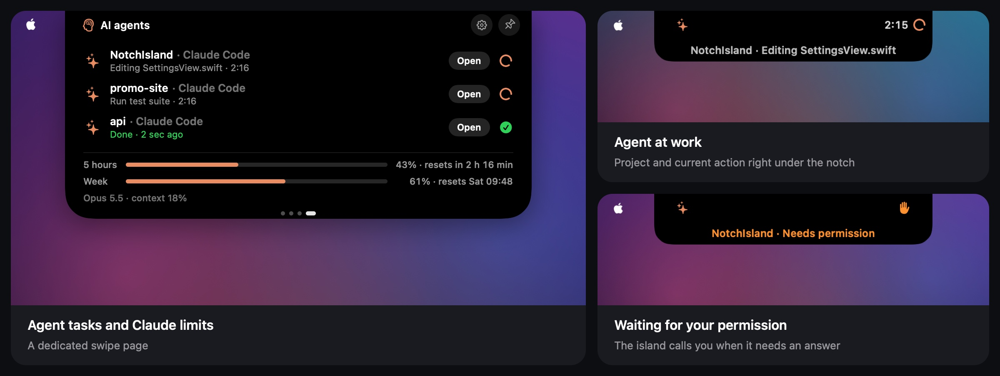
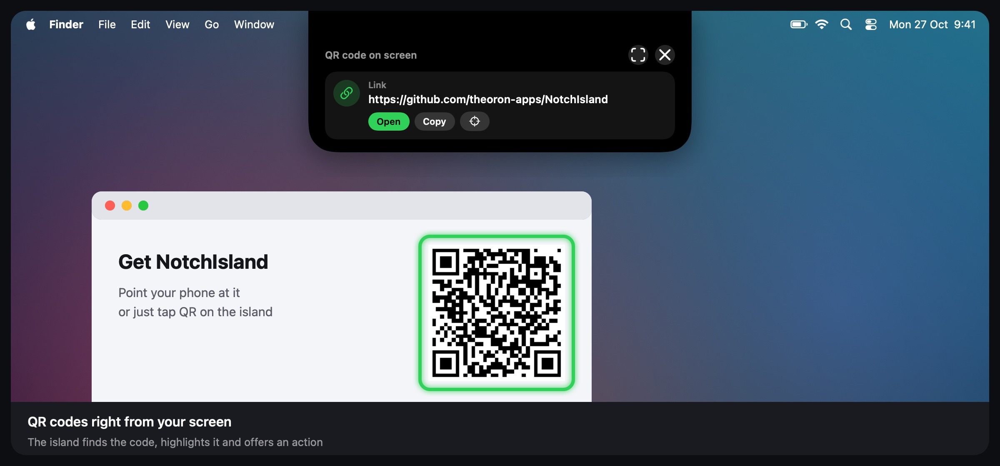

  

<h1 align="center">NotchIsland</h1>

Dynamic Island for MacBooks with a notch · by <a href="https://github.com/theoron-apps">Theoron</a>

  
  
  
  

  <a href="../../releases/latest"><b>Download</b></a> ·
  English · <a href="README.ru.md">Русский</a> · <a href="README.uk.md">Українська</a>

  

---

## Features

  

- **AI agents** — Claude Code and Codex right in the notch: which project they're on, what they're doing, when they need your permission, plus your Claude limits with warnings.
- **QR scanner** — finds QR codes on your screen, highlights them and offers the right action.
- **Music** — Apple Music, Spotify, Telegram songs and browser audio (Safari, Chrome, Firefox, Arc and more) with a live equalizer and a glow around the island.
- **Notifications in the notch** — charging, AirPods and other Bluetooth devices, network and VPN changes, high temperature, a too-bright screen on battery, a compact volume bar.
- **Activities** — timer, Keep Awake, camera and microphone indicators, calls. Up to three activities at once, shown in one of six styles.
- **Shelf** — a file tray with AirDrop and conversion, clipboard history and a quick note.
- **Stats & battery** — CPU, memory, GPU, disk, network, temperatures, power draw in watts and screen brightness in nits, with quick action buttons. Arrange the swipe pages any way you like.
- **Guided tour** on first launch and **What's New** right in the island after every update.
- **Automatic update checks** — the island tells you when a new version is out.
- Three island styles (black, glass, frosted glass), gestures, trackpad haptics, a soft glow at launch. English, Ukrainian and Russian.

## AI agents

  

NotchIsland shows what your coding agents are doing while you're in another window:

- **At work** — the project and the current action right under the notch: editing a file, running a command, searching.
- **Waiting for you** — the island turns orange and taps the trackpad when an agent needs permission, asks a question or wants a plan approved.
- **Done** — a short "Done" in the notch when a long task finishes.
- **Claude limits** — 5-hour and weekly usage with reset times, and a warning at 70, 80, 90 and 100%.
- **A dedicated page** — swipe to see all agent tasks and limits at once.

### Connect Claude Code and Codex

1. Open **Settings → AI Agents** and click **Connect…** next to Claude Code.
2. The folder picker opens on `~/.claude` — click **Allow**. NotchIsland saves a backup of `settings.json` next to it and adds its hook and status line. Your own hooks stay.
3. Start a new Claude Code session.
4. For Codex, do the same with `~/.codex`. Codex runs new hooks only after review: run `/hooks` in Codex and mark the NotchIsland hook as trusted.

Prefer to do it by hand? The same page has a step-by-step manual setup with everything to copy. **Disconnect** removes the hook, the script and the status line.

### Claude limits

- **Claude Code in the terminal** sends your limits through its status line automatically (Pro and Max plans).
- **The Claude app and claude.ai** don't share limits, so NotchIsland comes with a small browser helper that reads them from your claude.ai session once a minute:
  - **Chrome, Arc, Edge, Brave** — in Settings → AI Agents click **Save extension**, open `chrome://extensions`, turn on **Developer mode** and choose **Load unpacked** → the "NotchIsland for Chrome" folder in Downloads.
  - **Safari** — install the free [Userscripts](https://apps.apple.com/app/id1463298887) app, enable it for claude.ai, click **Save script** and move the file into the Userscripts scripts folder.

The helper only sends the limit percentages and reset times to the island at `127.0.0.1`. Your cookies and account never leave the browser. It's unofficial and may stop working if claude.ai changes.

## QR scanner

  

Click the **QR** button on the stats or battery page. The island looks for QR codes on all your screens, highlights them and offers the right action: open a link, copy a Wi‑Fi password, add a contact, write an email, call, or open a place in Maps. If a code isn't found, draw a frame around it.

The scanner needs **Screen Recording** access. The screenshot is only used to find the code and is never saved. Because the app isn't signed with a Developer ID yet, macOS may forget this access after an update — if the scanner keeps asking, remove NotchIsland with **−** in System Settings → Privacy & Security → Screen Recording and allow it again.

## Requirements

- macOS 15 Sequoia or later
- Liquid Glass island styles need macOS 26; on macOS 15 they use a blur instead
- A MacBook with a notch (other displays are supported as an option)

## Install

1. Download `NotchIsland-<version>.dmg` from [Releases](../../releases/latest).
2. Open the DMG and drag **NotchIsland** into **Applications**.
3. Open NotchIsland. macOS will say it can't verify the developer — click **Done**.
4. Open **System Settings → Privacy & Security** and scroll down to **Security**.
5. Click **Open Anyway** next to the NotchIsland message and confirm with your password or Touch ID.
6. Launch NotchIsland again — from now on it opens normally. A short tour will show you around.

Why: the app isn't signed with a paid Apple Developer ID yet, so macOS asks you to confirm the first launch once.

> Advanced: instead of steps 3–5 you can run
> `xattr -dr com.apple.quarantine /Applications/NotchIsland.app`

## How to use

| Action | What happens |
|---|---|
| Hover over the notch | The island expands and shows what's going on |
| Click the island | Opens the shelf: file tray, clipboard history and a note |
| Two-finger swipe on the expanded island | Switches pages: stats, battery, AI agents. Order and visibility in **Settings → Gestures** |
| Right-click the island | Quick menu: timer, Keep Awake, shelf, speed test, settings |
| Drag a file to the notch | Put it on the shelf, send it via AirDrop or convert it |
| Buttons on the stats and battery pages | Keep Awake, speed test, Activity Monitor, shelf, QR scanner, settings, pin |

Replay the tour anytime from **Settings → General → Tour**.

## Permissions

| Permission | Why |
|---|---|
| Automation (Music, Spotify, System Events) | show the current track, control playback, switch the theme |
| System audio recording | the live equalizer reacts to real sound; nothing is recorded or saved |
| Bluetooth | notifications when headphones and other devices connect |
| Location | only so macOS reveals the Wi‑Fi network name |
| Clipboard | clipboard history, if you turn it on |
| Screen Recording | only the QR scanner; the screenshot is never saved |
| The `~/.claude` and `~/.codex` folders you pick | to add the AI agent hook; a backup of the config is kept next to it |

You can revoke any of them in **System Settings → Privacy & Security**.

## Update

NotchIsland checks for a new version when it launches and once a day. When one is out, the island offers to **Download** it, remind you **Later** or **Skip** that version. Open the new DMG and replace the app in Applications — your settings are kept, and the island shows what's new.

You can turn the checks off or check manually in **Settings → About → Updates**.

## Privacy

- The app runs in the macOS sandbox and collects no analytics.
- Clipboard history, notes and settings stay on your Mac.
- AI agents: hooks send the island only the project folder name, the event and the tool name, through a local link. Prompts and file contents are never sent. The browser helper sends limit percentages to `127.0.0.1` and nothing else.
- Network access is limited to the optional internet speed test (Apple's servers, the same service `networkQuality` uses) and the update check against this GitHub repository, which sends nothing about you.

## Uninstall

If you connected AI agents, click **Disconnect** in Settings → AI Agents first, and remove the browser extension or script if you added it. A leftover hook does nothing without the app, but it's tidier this way.

Quit NotchIsland (right-click the island → Quit NotchIsland), delete it from Applications and, if you like, remove `~/Library/Containers/devplaceholder.WAZ2022C.NotchIsland`.

## Contact

News and support — Telegram [@TheoronApps](https://t.me/TheoronApps).
