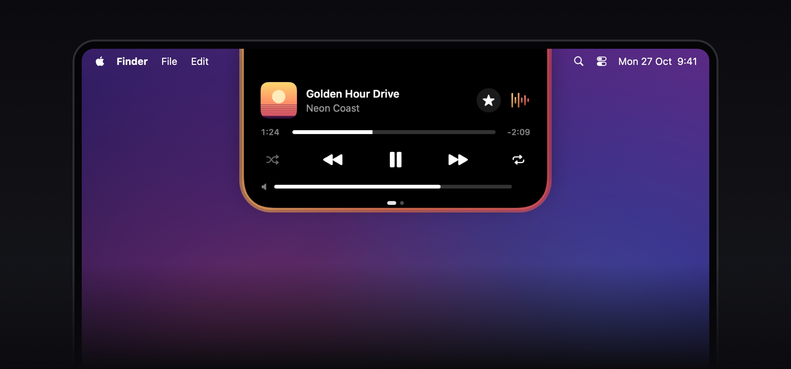
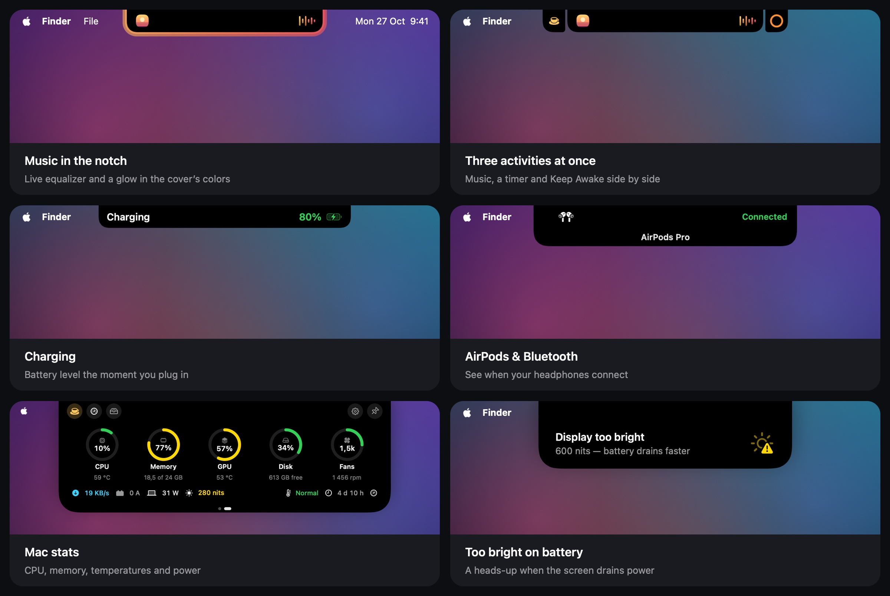

  

<h1 align="center">NotchIsland</h1>

Dynamic Island for MacBooks with a notch · by <a href="https://github.com/theoron-apps">Theoron</a>

  
  
  
  

  <a href="../../releases/latest"><b>Download</b></a> ·
  English · <a href="README.ru.md">Русский</a> · <a href="README.uk.md">Українська</a>

  

---

## Features

  

- **Music** — Apple Music, Spotify, Telegram songs and browser audio (Safari, Chrome, Firefox, Arc and more) with a live equalizer and a glow around the island.
- **Notifications in the notch** — charging, AirPods and other Bluetooth devices, network and VPN changes, high temperature, a too-bright screen on battery, a compact volume bar.
- **Activities** — timer, Keep Awake, camera and microphone indicators, calls. Up to three activities at once, shown in one of six styles.
- **Shelf** — a file tray with AirDrop and conversion, clipboard history and a quick note.
- **Stats & battery** — CPU, memory, GPU, disk, network, temperatures, power draw in watts and screen brightness in nits, with quick action buttons.
- **Guided tour** on first launch and **What's New** right in the island after every update.
- **Automatic update checks** — the island tells you when a new version is out.
- Three island styles (black, glass, frosted glass), gestures, trackpad haptics. English, Ukrainian and Russian.

## Requirements

- macOS 15 Sequoia or later
- Liquid Glass island styles need macOS 26; on macOS 15 they use a blur instead
- A MacBook with a notch (other displays are supported as an option)

## Install

1. Download `NotchIsland-<version>.dmg` from [Releases](../../releases/latest).
2. Open the DMG and drag **NotchIsland** into **Applications**.
3. Open NotchIsland. macOS will say it can't verify the developer — click **Done**.
4. Open **System Settings → Privacy & Security** and scroll down to **Security**.
5. Click **Open Anyway** next to the NotchIsland message and confirm with your password or Touch ID.
6. Launch NotchIsland again — from now on it opens normally. A short tour will show you around.

Why: the app isn't signed with a paid Apple Developer ID yet, so macOS asks you to confirm the first launch once.

> Advanced: instead of steps 3–5 you can run
> `xattr -dr com.apple.quarantine /Applications/NotchIsland.app`

## How to use

| Action | What happens |
|---|---|
| Hover over the notch | The island expands and shows what's going on |
| Click the island | Opens the shelf: file tray, clipboard history and a note |
| Two-finger swipe on the expanded island | Switches to Mac stats and battery |
| Right-click the island | Quick menu: timer, Keep Awake, shelf, speed test, settings |
| Drag a file to the notch | Put it on the shelf, send it via AirDrop or convert it |
| Buttons on the stats and battery pages | Keep Awake, speed test, Activity Monitor, shelf, settings, pin |

Replay the tour anytime from **Settings → General → Tour**.

## Permissions

| Permission | Why |
|---|---|
| Automation (Music, Spotify, System Events) | show the current track, control playback, switch the theme |
| System audio recording | the live equalizer reacts to real sound; nothing is recorded or saved |
| Bluetooth | notifications when headphones and other devices connect |
| Location | only so macOS reveals the Wi‑Fi network name |
| Clipboard | clipboard history, if you turn it on |

You can revoke any of them in **System Settings → Privacy & Security**.

## Update

NotchIsland checks for a new version when it launches and once a day. When one is out, the island offers to **Download** it, remind you **Later** or **Skip** that version. Open the new DMG and replace the app in Applications — your settings are kept, and the island shows what's new.

You can turn the checks off or check manually in **Settings → About → Updates**.

## Privacy

- The app runs in the macOS sandbox and collects no analytics.
- Clipboard history, notes and settings stay on your Mac.
- Network access is limited to the optional internet speed test (Apple's servers, the same service `networkQuality` uses) and the update check against this GitHub repository, which sends nothing about you.

## Uninstall

Quit NotchIsland (right-click the island → Quit NotchIsland), delete it from Applications and, if you like, remove `~/Library/Containers/devplaceholder.WAZ2022C.NotchIsland`.

## Contact

News and support — Telegram [@TheoronApps](https://t.me/TheoronApps).
