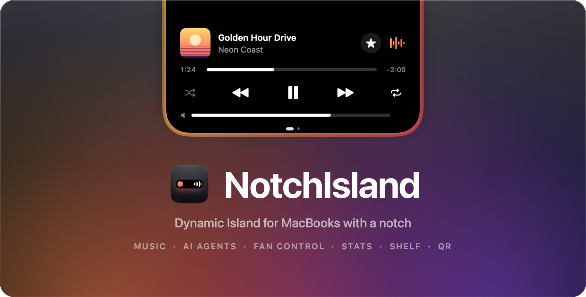
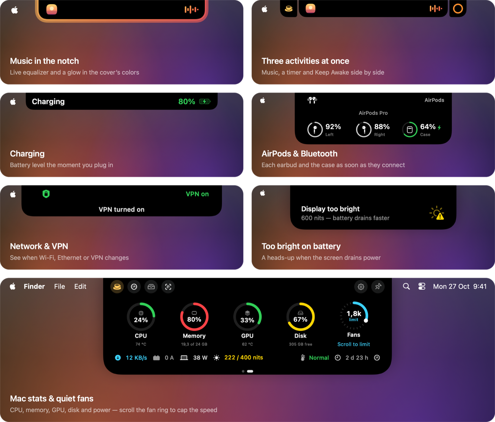
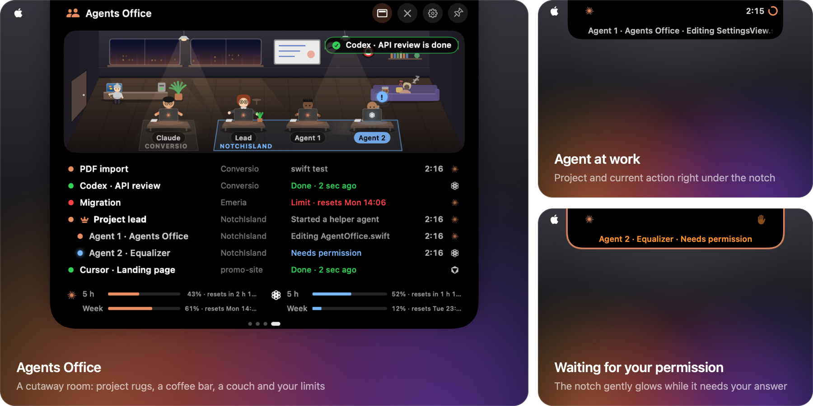
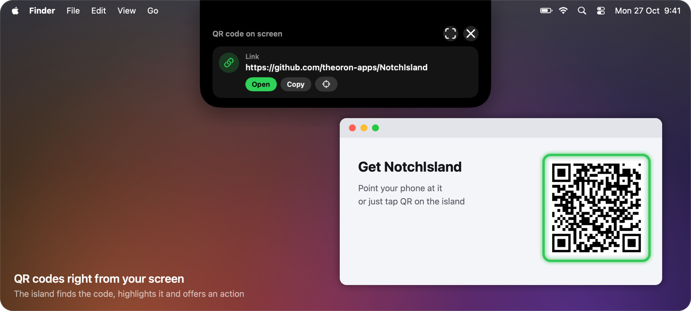

  

  
  
  
  
  

  by <a href="https://github.com/theoron-apps">Theoron</a> · English · <a href="README.ru.md">Русский</a> · <a href="README.uk.md">Українська</a>

---

## Features

  

- **Fan speed limit** — hover over the fan ring in stats and scroll: 100 rpm steps, from Auto down to full silence. Your Mac stays quiet under load, and above a temperature you choose the fans go back to automatic on their own. Apple silicon Macs with fans.
- **Agents Office** — Claude Code, Codex, Cursor and Antigravity at their project desks in a cutaway room: see who is working, who needs your permission, who is done and who hit a limit. A waiting agent makes the notch glow, plus Claude, Codex and Cursor limits with warnings.
- **QR scanner** — finds QR codes on your screen, highlights them and offers the right action.
- **Equalizer for every app** — music and video from any player, not just Apple Music and Spotify: YouTube in Safari, Chrome and Brave, podcasts, VLC, IINA, Telegram songs, and FL Studio while it's making sound. Title, time, seeking and controls right in the island, plus the video frame and channel with the NotchIsland browser extension. A live equalizer in four styles — Like iPhone, Instant, NotchIsland with tunable bars, and Just bars — a glow around the island and an optional narrow layout hugging the notch.
- **Notifications in the notch** — charging, AirPods and other Bluetooth devices, network and VPN changes, another Mac over a Thunderbolt cable, high temperature, a too-bright screen on battery, a compact volume bar.
- **Activities** — timer, Keep Awake, camera and microphone indicators, calls. Up to three activities at once, shown in one of six styles.
- **Shelf** — a file tray with AirDrop, conversion and PDF password removal, clipboard history and a quick note.
- **Stats & battery** — CPU, memory, GPU, disk, network, temperatures, power draw in watts and screen brightness in nits, with quick action buttons. Click the Memory ring to open the list of apps and processes with their memory, CPU and GPU, and quit what you don't need right from the island. Arrange the swipe pages any way you like.
- **Guided tour** on first launch and **What's New** right in the island after every update.
- **Automatic update checks** — the island tells you when a new version is out.
- Gestures, trackpad haptics, a soft glow at launch. English, Ukrainian and Russian.

## AI agents

  

NotchIsland shows what your coding agents are doing while you're in another window:

- **Agents Office** — a separate tab of the expanded island. It's a cutaway room with windows onto a city or the stars and lamps hanging from the ceiling. Working agents sit at desks, and agents of one project share a rug with its name. The one waiting stands up and waves while the rug lights up. Finished agents head to the lounge and find something to do: coffee, darts, the fish tank, the board, a guitar. Agents out of limits and those done long ago rest on the couch. Five themes: Studio, Night City, Orbit, Workshop and Neon. Below is the session list: the chat title, project, what the agent is doing and for how long. Hover a row to highlight its agent in the room, and the other way round. Claude's helpers appear under it. Finished sessions stay in the list for 30 minutes. While the office is open, finished and waiting agents show up as toasts in the corner of the room, and the island doesn't switch away. Close the tab with the cross and bring it back in Settings.
- **Main chat and forks** — when a project has "Agent N · …" chats, the chat without a number is the main one: it gets a crown in the list, sits first in a jacket with a plant on the desk, and its forks sit next to it in casual clothes. NotchIsland never makes up numbers that aren't in chat titles; Codex chats are labelled "Codex · title".
- **At work** — the project and the current action right under the notch: editing a file, running a command, searching.
- **Waiting for you** — the notch gently pulses and taps the trackpad when an agent needs permission, asks a question or wants a plan approved. Set the glow color, brightness and system sound in AI Agents.
- **Done** — a short "Done" in the notch when a long task finishes.
- **Limits** — 5-hour and weekly limits for Claude and Codex, monthly Auto and API limits for Cursor, with reset times and a warning at 70, 80, 90 and 100%. When several agents have limits, switch between them with tabs right on the island.

| Agent | Tasks and status | Waiting for permission | Limits |
|---|---|---|---|
| Claude Code | ✓ | ✓ | 5 hours and week |
| Codex | ✓ | ✓ | 5 hours and week, from the Codex session log |
| Cursor | ✓ | — | Auto and API, through the browser helper |
| Antigravity | ✓ | — | — |

Cursor and Antigravity don't tell hooks when they're waiting for your permission, so the island can't show that for them. Antigravity doesn't expose its limits at all — neither through hooks nor on a website.

### Connect your agents

1. Open **Settings → AI Agents** and click **Connect…** next to Claude Code.
2. NotchIsland saves a backup of `~/.claude/settings.json` next to it and adds its hook and status line. Your own hooks stay.
3. Start a new Claude Code session.
4. For Codex, click **Connect…** next to it, then approve the hooks in Codex — it doesn't run hooks until you do. In the Codex app, click **Allow all** in **Review hooks** above the input field, or open **Settings → Hooks** and click **Trust** on each NotchIsland hook. In the Codex CLI, run `/hooks`.
5. For Cursor, click **Connect…**, then restart Cursor. The hook goes into `~/.cursor/hooks.json`.
6. For Antigravity, click **Connect…**, then restart Antigravity — it reads hooks only at launch. The hook goes into `~/.gemini/config/hooks.json`.

Each agent has a step-by-step guide on the same page, plus a manual setup with everything to copy. **Disconnect** removes the hook, the script and the status line.

### Limits

- **Codex** writes your limits to its own session log on your Mac, and the island reads them after every agent reply. Nothing to install.
- **Claude Code in the terminal** sends your limits through its status line automatically (Pro and Max plans).
- **The Claude app, claude.ai and Cursor** don't share limits, so NotchIsland comes with a small browser helper that reads them from your claude.ai and cursor.com sessions once a minute:
  - **Chrome, Arc, Edge, Brave** — in Settings → AI Agents click **Save extension**, open `chrome://extensions`, turn on **Developer mode** and choose **Load unpacked** → the "NotchIsland for Chrome" folder in Downloads. Updating from an older version? Save it again and click **Reload** on the extension.
  - **Safari** — install the free [Userscripts](https://apps.apple.com/app/id1463298887) app, enable it for claude.ai and cursor.com, click **Save script** and move the file into the Userscripts scripts folder, replacing the old one.

The helper only sends the limit percentages and reset times to the island at `127.0.0.1`. Your cookies and account never leave the browser. It's unofficial and may stop working if claude.ai or cursor.com changes.

## QR scanner

  

Click the **QR** button on the stats or battery page. The island looks for QR codes on all your screens, highlights them and offers the right action: open a link, copy a Wi‑Fi password, add a contact, write an email, call, or open a place in Maps. If a code isn't found, draw a frame around it.

The scanner needs **Screen Recording** access. The screenshot is only used to find the code and is never saved. Because the app isn't signed with a Developer ID yet, macOS may forget this access after an update — if the scanner keeps asking, remove NotchIsland with **−** in System Settings → Privacy & Security → Screen Recording and allow it again.

## Requirements

- macOS 15 Sequoia or later
- A MacBook with a notch (other displays are supported as an option)

## Install

1. Download `NotchIsland-<version>.dmg` from [Releases](../../releases/latest).
2. Open the DMG and drag **NotchIsland** into **Applications**.
3. Open NotchIsland. macOS will say it can't verify the developer — click **Done**.
4. Open **System Settings → Privacy & Security** and scroll down to **Security**.
5. Click **Open Anyway** next to the NotchIsland message and confirm with your password or Touch ID.
6. Launch NotchIsland again — from now on it opens normally. A short tour will show you around.

Why: the app isn't signed with a paid Apple Developer ID yet, so macOS asks you to confirm the first launch once.

> Advanced: instead of steps 3–5 you can run
> `xattr -dr com.apple.quarantine /Applications/NotchIsland.app`

## How to use

| Action | What happens |
|---|---|
| Hover over the notch | The island expands and shows what's going on |
| Click the island | Opens the shelf: file tray, clipboard history and a note |
| Two-finger swipe on the expanded island | Switches pages: stats, battery, Agents Office. Order and visibility in **Settings → Gestures** |
| Two-finger swipe up on the island | Hides it into the notch. Swipe down on the notch to bring it back; a new activity or track brings it back too |
| Right-click the island | Quick menu: timer, Keep Awake, shelf, speed test, settings |
| Drag a file to the notch | Put it on the shelf, send it via AirDrop or convert it |
| Buttons on the stats and battery pages | Keep Awake, speed test, Activity Monitor, shelf, QR scanner, settings, pin |

Replay the tour anytime from **Settings → General → Tour**.

## Permissions

| Permission | Why |
|---|---|
| Automation (Music, Spotify, System Events) | show the current track, control playback, switch the theme |
| System audio recording | the live equalizer reacts to real sound; nothing is recorded or saved |
| Bluetooth | notifications when headphones and other devices connect |
| Location | only so macOS reveals the Wi‑Fi network name |
| Clipboard | clipboard history, if you turn it on |
| Screen Recording | only the QR scanner; the screenshot is never saved |
| The `~/.claude`, `~/.codex`, `~/.cursor` and `~/.gemini` folders, only when you click **Connect…** | to add the AI agent hook; a backup of the config is kept next to it |
| Administrator password | only to install or remove the fan helper, if you turn on the fan speed limit |

You can revoke any of them in **System Settings → Privacy & Security**.

## Fan control and the sandbox

Since 6.1 NotchIsland is no longer sandboxed. macOS lets only an administrator process change fan speed, and a sandboxed app can't install one, so the fan limit can't exist inside the sandbox.

- Fan speed is changed by a small helper built into the app. When you turn fan control on, it is copied to `/Library/PrivilegedHelperTools` and registered in `/Library/LaunchDaemons`, both named `devplaceholder.WAZ2022C.NotchIsland.FanHelper`.
- The helper does only two things: hold the fans at a given speed within the range your Mac reports, or hand them back to macOS. It takes commands only from NotchIsland, returns the fans to automatic if the island quits, crashes or stops talking to it for 20 seconds, and exits on its own when idle.
- It is installed only when you turn on **Settings → Permissions → Fan control**, after you enter your administrator password. **Turn Off** asks for the password again and removes both files.
- The island also hands the fans back to macOS above a chip temperature (CPU or GPU, whichever is hotter) you choose in Settings → Permissions, and always at 100 °C or when macOS reports critical heat.
- Fan control works only on Apple silicon Macs with fans. NotchIsland reads and writes the Mac's SMC directly, which is not a public Apple API, as other fan apps do.
- Nothing else changed: no analytics, no new network access. Your settings and clipboard history move out of the old sandbox container on the first launch.

## Update

NotchIsland checks for a new version when it launches and once a day. When one is out, the island offers to **Download** it, remind you **Later** or **Skip** that version. Open the new DMG and replace the app in Applications — your settings are kept, and the island shows what's new.

You can turn the checks off or check manually in **Settings → What's new → Updates**.

## Privacy

- The app collects no analytics. It isn't sandboxed since 6.1 — see [Fan control and the sandbox](#fan-control-and-the-sandbox).
- Clipboard history, notes and settings stay on your Mac.
- AI agents: hooks send the island only the project folder name, the event and the tool name, through a local link. The office reads chat titles and session state on your Mac from the `~/.claude` and `~/.codex` folders of connected agents, only from the end of the logs. Conversations are never stored or sent anywhere. The browser helper sends only limit percentages and the YouTube video you are watching (title, channel, time) to `127.0.0.1`.
- Network access is limited to the optional internet speed test (Apple's servers, the same service `networkQuality` uses) the update check against this GitHub repository, which sends nothing about you, and the YouTube video frame from `i.ytimg.com` when the browser extension is on.

## Uninstall

If you connected AI agents, click **Disconnect** in Settings → AI Agents first, and remove the browser extension or script if you added it. A leftover hook does nothing without the app, but it's tidier this way. If you turned on fan control, click **Turn Off** in Settings → Permissions — otherwise the idle helper stays in `/Library/PrivilegedHelperTools`.

Quit NotchIsland (right-click the island → Quit NotchIsland), delete it from Applications and, if you like, remove `~/Library/Application Support/NotchIsland`, `~/Library/Preferences/devplaceholder.WAZ2022C.NotchIsland.plist` and the old `~/Library/Containers/devplaceholder.WAZ2022C.NotchIsland`.

## Trademarks

Claude and Claude Code are trademarks of Anthropic, Codex of OpenAI, Cursor of Anysphere and Antigravity of Google. NotchIsland is an independent app and is not affiliated with, sponsored or endorsed by these companies. Agent icons in the app are simplified drawings used only to tell the agents apart.

## Contact

News and support — Telegram [@TheoronApps](https://t.me/TheoronApps).
