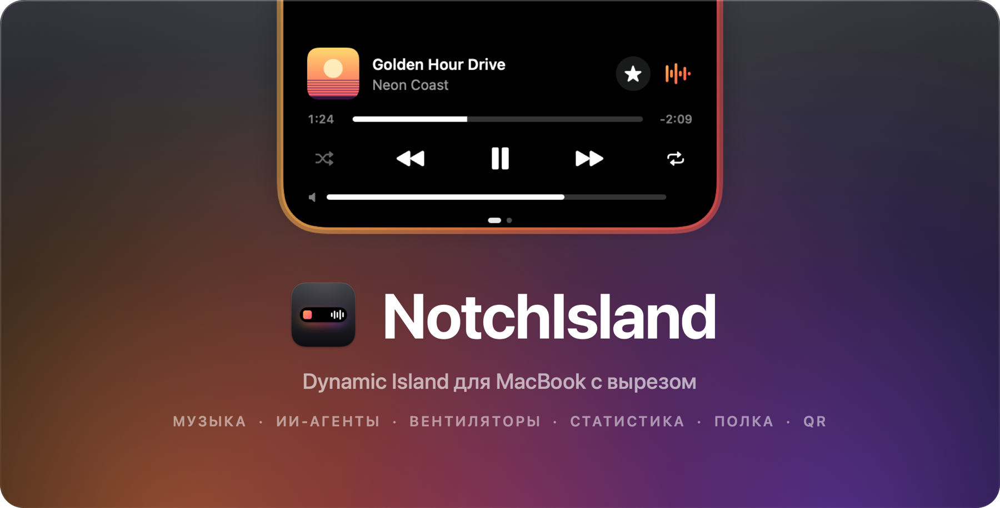
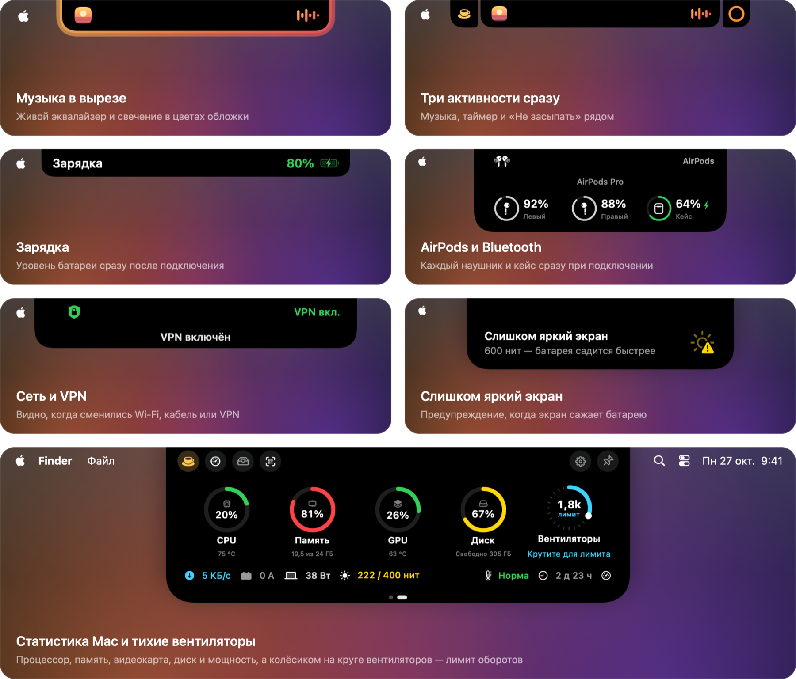
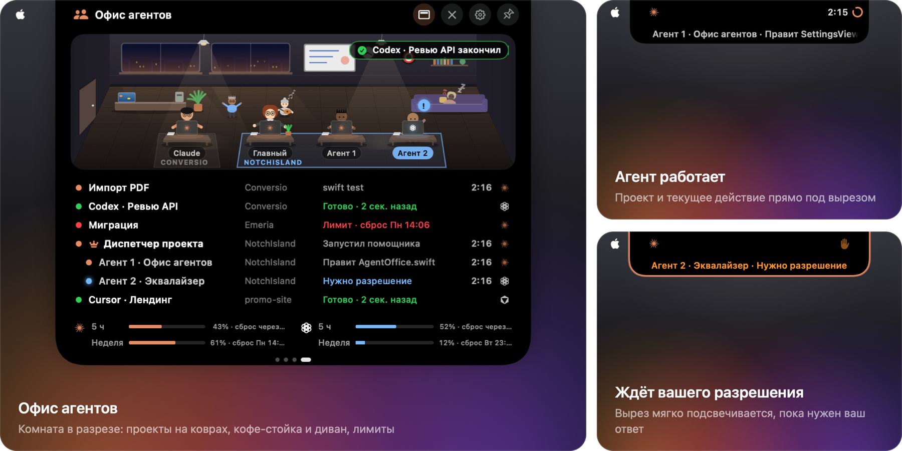
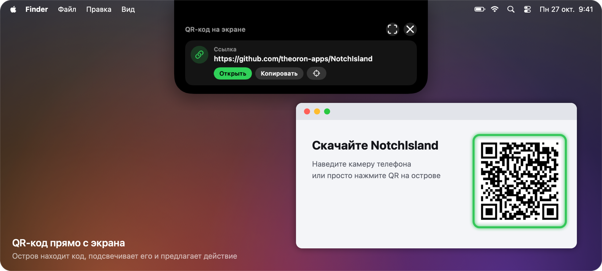

  

  
  
  
  
  

  от <a href="https://github.com/theoron-apps">Theoron</a> · <a href="README.md">English</a> · Русский · <a href="README.uk.md">Українська</a>

---

## Что умеет

  

- **Лимит оборотов вентиляторов** — наведите курсор на круг вентиляторов в статистике и крутите колёсико: шаг 100 об/мин, от «Авто» до полной тишины. Mac остаётся тихим под нагрузкой, а выше заданной вами температуры вентиляторы сами возвращаются на автоматику. Mac с Apple Silicon и вентиляторами.
- **Офис агентов** — Claude Code, Codex, Cursor и Antigravity в комнате-разрезе за столами своих проектов: видно, кто работает, кто ждёт вашего разрешения, кто закончил и кто упёрся в лимит. Ждущий агент подсвечивает вырез, а ещё есть лимиты Claude, Codex и Cursor с предупреждениями.
- **QR-сканер** — находит QR-коды на экране, подсвечивает их и предлагает нужное действие.
- **Эквалайзер для всех приложений** — музыка и видео из любого плеера, а не только из Apple Music и Spotify: YouTube в Safari, Chrome и Brave, подкасты, VLC, IINA, песни из Telegram, а пока звучит FL Studio — и она. Название, время, перемотка и кнопки прямо в острове, а с расширением NotchIsland для браузера — ещё и кадр видео с каналом. Живой эквалайзер в четырёх стилях — «Как на iPhone», «Мгновенный», NotchIsland с настройкой полосок и «Просто полоски», — подсветка вокруг острова и узкий вариант вплотную к вырезу.
- **Уведомления в вырезе** — зарядка, AirPods и другие Bluetooth-устройства, смена сети и VPN, второй Mac по кабелю Thunderbolt, сильный нагрев, слишком яркий экран на батарее, компактная полоска громкости.
- **Активности** — таймер, «Не засыпать», индикаторы камеры и микрофона, звонки. До трёх активностей сразу, в одном из шести стилей на выбор.
- **Полка** — лоток для файлов с AirDrop, конвертацией и снятием пароля с PDF, история буфера обмена, заметка.
- **Статистика и батарея** — процессор, память, видеокарта, диск, сеть, температура, потребление в ваттах и яркость экрана в нитах, с кнопками быстрых действий. Нажмите на круг «Память» — откроется список приложений и процессов с памятью, CPU и GPU, и лишнее можно завершить прямо из острова. Страницы в свайпах можно расставить как угодно.
- **Обучение** при первом запуске и **«Что нового»** прямо в острове после каждого обновления.
- **Автоматическая проверка обновлений** — остров сам сообщит о новой версии.
- Жесты, тактильный отклик трекпада, мягкое свечение при запуске. Русский, украинский и английский.

## ИИ-агенты

  

NotchIsland показывает, что делают ваши агенты, пока вы в другом окне:

- **Офис агентов** — отдельная вкладка раскрытого острова. Это комната в разрезе: окна с городом или звёздами, лампы под потолком. Работающие агенты сидят за столами, агенты одного проекта — на общем ковре с его названием. Ждущий встаёт и машет, а ковёр подсвечивается. Закончившие уходят в зону отдыха и сами находят занятие: кофе, дартс, рыбки, доска, гитара. Упёршиеся в лимит и давно закончившие отдыхают на диване. Пять тем оформления: «Студия», «Ночной город», «Орбита», «Мастерская» и «Неон». Ниже — список сессий: название чата, проект, что агент делает сейчас и сколько времени. Наведите курсор на строку — агент в комнате подсветится, и наоборот. Под агентом Claude видны его помощники. Закончившие сессии остаются в списке 30 минут. Пока офис открыт, о конце работы и ожидании сообщают плашки в углу комнаты — остров не переключается. Вкладку можно убрать крестиком и вернуть в настройках.
- **Главный чат и форки** — если в проекте есть чаты «Агент N · …», чат без номера считается главным: в списке у него корона, в комнате он сидит первым, в пиджаке и с цветком на столе, а форки — рядом и попроще. Номеров, которых нет в названиях чатов, NotchIsland не придумывает; чаты Codex подписаны «Codex · название».
- **Работает** — проект и текущее действие прямо под вырезом: правит файл, запускает команду, ищет.
- **Ждёт вас** — вырез мягко пульсирует и щёлкает трекпадом, когда агенту нужно разрешение, он задаёт вопрос или ждёт одобрения плана. Цвет, яркость и системный звук подсветки настраиваются в «ИИ-агентах».
- **Готово** — короткое «Готово» в вырезе, когда закончилась долгая задача.
- **Лимиты** — у Claude и Codex 5-часовой и недельный, у Cursor месячные Auto и API, со временем сброса и предупреждением на 70, 80, 90 и 100%. Если лимиты есть у нескольких агентов, между ними можно переключаться вкладками прямо на острове.

| Агент | Задачи и статус | Ждёт разрешения | Лимиты |
|---|---|---|---|
| Claude Code | ✓ | ✓ | 5 часов и неделя |
| Codex | ✓ | ✓ | 5 часов и неделя, из журнала сессий Codex |
| Cursor | ✓ | — | Auto и API, через помощника для браузера |
| Antigravity | ✓ | — | — |

Cursor и Antigravity не сообщают хукам, что ждут вашего разрешения, поэтому остров не может это показать. Лимиты Antigravity не отдаёт вообще — ни через хуки, ни на сайте.

### Как подключить агентов

1. Откройте **«Настройки» → «ИИ-агенты»** и нажмите **«Подключить…»** у Claude Code.
2. NotchIsland сохранит рядом копию `~/.claude/settings.json` и добавит свой хук и строку состояния. Ваши хуки останутся.
3. Начните новую сессию Claude Code.
4. Для Codex нажмите **«Подключить…»** рядом с ним, а затем одобрите хуки в Codex: без этого он их не запускает. В приложении Codex нажмите **Allow all** в окне **Review hooks** над полем ввода или откройте **«Настройки» → Hooks** и нажмите **Trust** у каждого хука NotchIsland. В терминальном Codex — команда `/hooks`.
5. Для Cursor нажмите **«Подключить…»** и перезапустите Cursor. Хук добавится в `~/.cursor/hooks.json`.
6. Для Antigravity нажмите **«Подключить…»** и перезапустите Antigravity — он читает хуки только при запуске. Хук добавится в `~/.gemini/config/hooks.json`.

Для каждого агента на той же странице есть пошаговая инструкция, а ещё ручная настройка со всем, что нужно скопировать. **«Отключить»** убирает хук, скрипт и строку состояния.

### Лимиты

- **Codex** сам записывает лимиты в свой журнал сессий на вашем Mac, а остров читает их после каждого ответа агента. Ничего ставить не нужно.
- **Claude Code в терминале** передаёт лимиты сам, через строку состояния (подписки Pro и Max).
- **Приложение Claude, claude.ai и Cursor** лимиты не отдают, поэтому у NotchIsland есть маленький помощник для браузера: раз в минуту он берёт лимиты из вашей сессии на claude.ai и cursor.com.
  - **Chrome, Arc, Edge, Brave** — в «Настройки» → «ИИ-агенты» нажмите **«Сохранить расширение»**, откройте `chrome://extensions`, включите **«Режим разработчика»** и выберите **«Загрузить распакованное»** → папка «NotchIsland for Chrome» в «Загрузках». Уже ставили старую версию? Сохраните расширение снова и нажмите **«Обновить»** у него.
  - **Safari** — поставьте бесплатное приложение [Userscripts](https://apps.apple.com/app/id1463298887), разрешите его для claude.ai и cursor.com, нажмите **«Сохранить скрипт»** и перенесите файл в папку скриптов Userscripts вместо старого.

Помощник передаёт острову по адресу `127.0.0.1` только проценты лимитов и время сброса. Cookies и аккаунт не покидают браузер. Способ неофициальный и может перестать работать после обновления claude.ai или cursor.com.

## QR-сканер

  

Нажмите кнопку **QR** на странице статистики или батареи. Остров ищет QR-коды на всех экранах, подсвечивает их и предлагает нужное действие: открыть ссылку, скопировать пароль Wi‑Fi, добавить контакт, написать письмо, позвонить или открыть место в Картах. Если код не нашёлся, обведите его рамкой.

Сканеру нужен доступ к **записи экрана**. Снимок нужен только чтобы найти код и нигде не сохраняется. Приложение пока без подписи Developer ID, поэтому после обновления macOS может забыть этот доступ — если сканер снова просит разрешение, удалите NotchIsland кнопкой **«−»** в «Системных настройках» → «Конфиденциальность и безопасность» → «Запись экрана» и разрешите заново.

## Требования

- macOS 15 Sequoia или новее
- MacBook с вырезом (на других экранах — по желанию)

## Установка

1. Скачайте `NotchIsland-<версия>.dmg` на странице [Releases](../../releases/latest).
2. Откройте DMG и перетащите **NotchIsland** в **«Программы»**.
3. Откройте NotchIsland. macOS скажет, что не может проверить разработчика, — нажмите **«Готово»**.
4. Откройте **«Системные настройки» → «Конфиденциальность и безопасность»** и прокрутите до раздела **«Безопасность»**.
5. Рядом с сообщением о NotchIsland нажмите **«Всё равно открыть»** и подтвердите паролем или Touch ID.
6. Запустите NotchIsland снова — дальше он открывается как обычно. Короткое обучение всё покажет.

Почему так: приложение пока без платной подписи Apple (Developer ID), поэтому macOS один раз просит подтвердить запуск.

> Для опытных: вместо шагов 3–5 можно выполнить
> `xattr -dr com.apple.quarantine /Applications/NotchIsland.app`

## Как пользоваться

| Действие | Что произойдёт |
|---|---|
| Навести курсор на вырез | Остров раскроется и покажет, что происходит |
| Кликнуть по острову | Откроется полка: лоток, история буфера обмена и заметка |
| Провести двумя пальцами по раскрытому острову | Переключает страницы: статистика, батарея, офис агентов. Порядок и видимость — в **«Настройки» → «Жесты»** |
| Смахнуть двумя пальцами вверх по острову | Остров прячется в вырез. Смахните вниз по вырезу, чтобы вернуть; новая активность или трек тоже вернут его |
| Правый клик по острову | Быстрое меню: таймер, «Не засыпать», полка, тест скорости, настройки |
| Перетащить файл к вырезу | Положить в лоток, отправить по AirDrop или сконвертировать |
| Кнопки на страницах статистики и батареи | «Не засыпать», тест скорости, мониторинг системы, полка, QR-сканер, настройки, закрепление |

Пройти обучение заново можно в **«Настройки» → «Основные» → «Обучение»**.

## Разрешения

| Разрешение | Зачем |
|---|---|
| Автоматизация (Music, Spotify, System Events) | показывать трек, управлять плеером, переключать тему |
| Запись системного звука | эквалайзер двигается от настоящего звука; ничего не записывается и не сохраняется |
| Bluetooth | уведомления о подключении наушников и других устройств |
| Геопозиция | только чтобы macOS показала имя сети Wi‑Fi |
| Буфер обмена | история копирования, если вы её включили |
| Запись экрана | только для QR-сканера; снимок нигде не сохраняется |
| Папки `~/.claude`, `~/.codex`, `~/.cursor` и `~/.gemini`, только когда вы нажимаете **«Подключить…»** | чтобы добавить хук ИИ-агентов; рядом остаётся копия настроек |
| Пароль администратора | только чтобы установить или удалить помощника вентиляторов, если вы включили лимит оборотов |

Любое разрешение можно отозвать в **«Системных настройках» → «Конфиденциальность и безопасность»**.

## Вентиляторы и песочница

С версии 6.1 NotchIsland работает без песочницы macOS. Менять обороты вентиляторов macOS разрешает только процессу с правами администратора, а приложение в песочнице не может его установить. Поэтому внутри песочницы лимита оборотов быть не может.

- Обороты меняет маленький помощник, встроенный в приложение. Когда вы включаете управление вентиляторами, он копируется в `/Library/PrivilegedHelperTools` и регистрируется в `/Library/LaunchDaemons`, оба файла называются `devplaceholder.WAZ2022C.NotchIsland.FanHelper`.
- Помощник умеет только две вещи: держать вентиляторы на заданных оборотах в пределах, которые сообщает сам Mac, или вернуть их macOS. Он принимает команды только от NotchIsland, возвращает вентиляторам автоматику, если остров закрылся, упал или 20 секунд ничего не присылал, и сам выключается без дела.
- Он ставится, только если вы включите **«Настройки» → «Разрешения» → «Управление вентиляторами»** и введёте пароль администратора. Кнопка **«Выключить»** снова спросит пароль и удалит оба файла.
- Остров тоже возвращает вентиляторы macOS выше температуры чипа (процессора или видеокарты — что горячее), которую вы задаёте в «Настройки» → «Разрешения», и в любом случае при 100 °C или когда macOS сообщает о критическом нагреве.
- Управление вентиляторами работает только на Mac с Apple Silicon и вентиляторами. Как и другие программы для вентиляторов, NotchIsland напрямую читает и пишет в контроллер Mac (SMC), а это не публичный API Apple.
- Больше ничего не изменилось: статистика не собирается, нового доступа в сеть нет. Настройки и история буфера при первом запуске сами переезжают из старого контейнера песочницы.

## Обновление

NotchIsland проверяет новую версию при запуске и раз в день. Когда она выйдет, остров предложит **«Скачать»**, напомнить **«Позже»** или **«Пропустить»** эту версию. Откройте новый DMG и замените приложение в «Программах» — настройки сохранятся, а остров покажет, что нового.

Отключить проверку или проверить вручную можно в **«Настройки» → «Что нового» → «Обновления»**.

## Приватность

- Приложение не собирает статистику. С версии 6.1 оно работает без песочницы — подробнее в разделе [«Вентиляторы и песочница»](#вентиляторы-и-песочница).
- История буфера, заметки и настройки хранятся только на вашем Mac.
- ИИ-агенты: хуки передают острову по локальной ссылке только название папки проекта, событие и имя инструмента. Названия чатов и состояние сессий офис читает на вашем Mac из папок `~/.claude` и `~/.codex` подключённых агентов, только с конца журналов. Тексты переписок не сохраняются и никуда не передаются. Помощник для браузера отправляет на `127.0.0.1` только проценты лимитов и смотримое видео YouTube (название, канал, время).
- В сеть приложение ходит только для теста скорости интернета (серверы Apple, тот же сервис, что у `networkQuality`) для проверки обновлений в этом репозитории, которая ничего о вас не передаёт, и за кадром видео YouTube с `i.ytimg.com`, если включено расширение для браузера.

## Удаление

Если вы подключали ИИ-агентов, сначала нажмите **«Отключить»** в «Настройки» → «ИИ-агенты» и удалите расширение или скрипт для браузера, если ставили. Без приложения оставшийся хук ничего не делает, но так аккуратнее. Если включали управление вентиляторами, нажмите **«Выключить»** в «Настройки» → «Разрешения» — иначе бездействующий помощник останется в `/Library/PrivilegedHelperTools`.

Закройте NotchIsland (правый клик по острову → «Выйти из NotchIsland»), удалите его из «Программ» и при желании `~/Library/Application Support/NotchIsland`, `~/Library/Preferences/devplaceholder.WAZ2022C.NotchIsland.plist` и старую папку `~/Library/Containers/devplaceholder.WAZ2022C.NotchIsland`.

## Товарные знаки

Claude и Claude Code — товарные знаки Anthropic, Codex — OpenAI, Cursor — Anysphere, Antigravity — Google. NotchIsland — независимое приложение и не связано с этими компаниями, не спонсируется и не одобрено ими. Значки агентов в приложении — упрощённые рисунки, только чтобы агентов было легко различить.

## Связь

Новости и вопросы — Telegram [@TheoronApps](https://t.me/TheoronApps).
