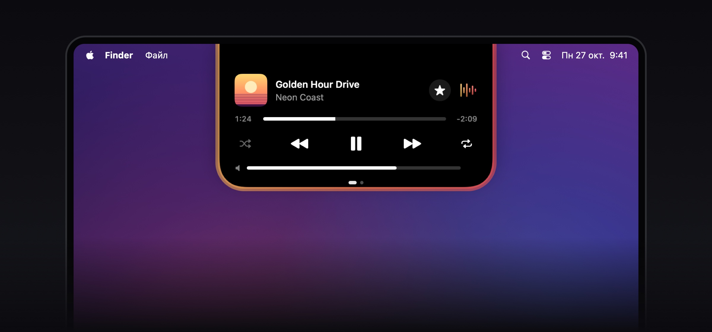
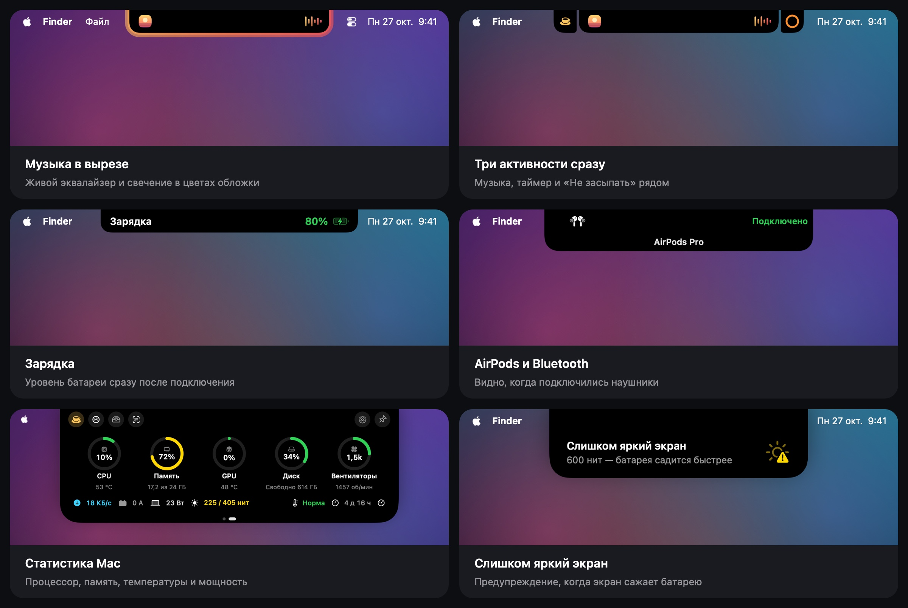
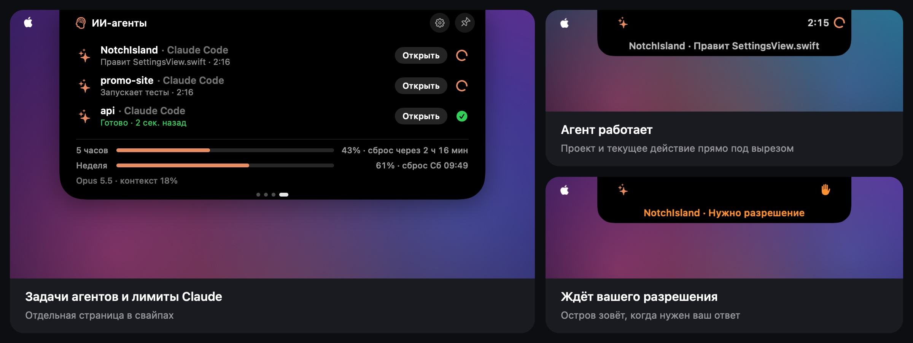
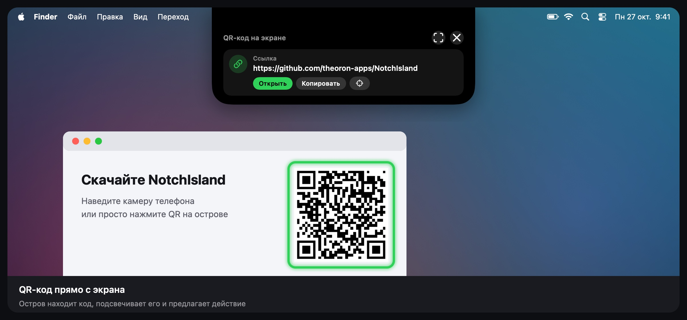

  

<h1 align="center">NotchIsland</h1>

Dynamic Island для MacBook с вырезом · от <a href="https://github.com/theoron-apps">Theoron</a>

  
  
  
  

  <a href="../../releases/latest"><b>Скачать</b></a> ·
  <a href="README.md">English</a> · Русский · <a href="README.uk.md">Українська</a>

  

---

## Что умеет

  

- **ИИ-агенты** — Claude Code и Codex прямо в вырезе: над каким проектом работают, что делают сейчас, когда ждут вашего разрешения, а ещё лимиты Claude с предупреждениями.
- **QR-сканер** — находит QR-коды на экране, подсвечивает их и предлагает нужное действие.
- **Музыка** — Apple Music, Spotify, песни из Telegram и звук из браузеров (Safari, Chrome, Firefox, Arc и других) с живым эквалайзером и подсветкой вокруг острова.
- **Уведомления в вырезе** — зарядка, AirPods и другие Bluetooth-устройства, смена сети и VPN, сильный нагрев, слишком яркий экран на батарее, компактная полоска громкости.
- **Активности** — таймер, «Не засыпать», индикаторы камеры и микрофона, звонки. До трёх активностей сразу, в одном из шести стилей на выбор.
- **Полка** — лоток для файлов с AirDrop и конвертацией, история буфера обмена, заметка.
- **Статистика и батарея** — процессор, память, видеокарта, диск, сеть, температура, потребление в ваттах и яркость экрана в нитах, с кнопками быстрых действий. Страницы в свайпах можно расставить как угодно.
- **Обучение** при первом запуске и **«Что нового»** прямо в острове после каждого обновления.
- **Автоматическая проверка обновлений** — остров сам сообщит о новой версии.
- Три стиля острова (чёрный, стекло, матовое стекло), жесты, тактильный отклик трекпада, мягкое свечение при запуске. Русский, украинский и английский.

## ИИ-агенты

  

NotchIsland показывает, что делают ваши агенты, пока вы в другом окне:

- **Работает** — проект и текущее действие прямо под вырезом: правит файл, запускает команду, ищет.
- **Ждёт вас** — остров становится оранжевым и щёлкает трекпадом, когда агенту нужно разрешение, он задаёт вопрос или ждёт одобрения плана.
- **Готово** — короткое «Готово» в вырезе, когда закончилась долгая задача.
- **Лимиты Claude** — 5-часовой и недельный, со временем сброса и предупреждением на 70, 80, 90 и 100%.
- **Отдельная страница** — свайп, и видны все задачи агентов и лимиты сразу.

### Как подключить Claude Code и Codex

1. Откройте **«Настройки» → «ИИ-агенты»** и нажмите **«Подключить…»** у Claude Code.
2. Окно выбора откроется на папке `~/.claude` — нажмите **«Разрешить»**. NotchIsland сохранит рядом копию `settings.json` и добавит свой хук и строку состояния. Ваши хуки останутся.
3. Начните новую сессию Claude Code.
4. Для Codex — то же самое с папкой `~/.codex`. Codex запускает новые хуки только после проверки: выполните в нём `/hooks` и отметьте хук NotchIsland как доверенный.

Хотите вручную? На той же странице есть пошаговая ручная настройка со всем, что нужно скопировать. **«Отключить»** убирает хук, скрипт и строку состояния.

### Лимиты Claude

- **Claude Code в терминале** передаёт лимиты сам, через строку состояния (подписки Pro и Max).
- **Приложение Claude и claude.ai** лимиты не отдают, поэтому у NotchIsland есть маленький помощник для браузера: раз в минуту он берёт лимиты из вашей сессии на claude.ai.
  - **Chrome, Arc, Edge, Brave** — в «Настройки» → «ИИ-агенты» нажмите **«Сохранить расширение»**, откройте `chrome://extensions`, включите **«Режим разработчика»** и выберите **«Загрузить распакованное»** → папка «NotchIsland for Chrome» в «Загрузках».
  - **Safari** — поставьте бесплатное приложение [Userscripts](https://apps.apple.com/app/id1463298887), разрешите его для claude.ai, нажмите **«Сохранить скрипт»** и перенесите файл в папку скриптов Userscripts.

Помощник передаёт острову по адресу `127.0.0.1` только проценты лимитов и время сброса. Cookies и аккаунт не покидают браузер. Способ неофициальный и может перестать работать после обновления claude.ai.

## QR-сканер

  

Нажмите кнопку **QR** на странице статистики или батареи. Остров ищет QR-коды на всех экранах, подсвечивает их и предлагает нужное действие: открыть ссылку, скопировать пароль Wi‑Fi, добавить контакт, написать письмо, позвонить или открыть место в Картах. Если код не нашёлся, обведите его рамкой.

Сканеру нужен доступ к **записи экрана**. Снимок нужен только чтобы найти код и нигде не сохраняется. Приложение пока без подписи Developer ID, поэтому после обновления macOS может забыть этот доступ — если сканер снова просит разрешение, удалите NotchIsland кнопкой **«−»** в «Системных настройках» → «Конфиденциальность и безопасность» → «Запись экрана» и разрешите заново.

## Требования

- macOS 15 Sequoia или новее
- Стеклянные стили острова (Liquid Glass) — на macOS 26; на macOS 15 вместо них размытие
- MacBook с вырезом (на других экранах — по желанию)

## Установка

1. Скачайте `NotchIsland-<версия>.dmg` на странице [Releases](../../releases/latest).
2. Откройте DMG и перетащите **NotchIsland** в **«Программы»**.
3. Откройте NotchIsland. macOS скажет, что не может проверить разработчика, — нажмите **«Готово»**.
4. Откройте **«Системные настройки» → «Конфиденциальность и безопасность»** и прокрутите до раздела **«Безопасность»**.
5. Рядом с сообщением о NotchIsland нажмите **«Всё равно открыть»** и подтвердите паролем или Touch ID.
6. Запустите NotchIsland снова — дальше он открывается как обычно. Короткое обучение всё покажет.

Почему так: приложение пока без платной подписи Apple (Developer ID), поэтому macOS один раз просит подтвердить запуск.

> Для опытных: вместо шагов 3–5 можно выполнить
> `xattr -dr com.apple.quarantine /Applications/NotchIsland.app`

## Как пользоваться

| Действие | Что произойдёт |
|---|---|
| Навести курсор на вырез | Остров раскроется и покажет, что происходит |
| Кликнуть по острову | Откроется полка: лоток, история буфера обмена и заметка |
| Провести двумя пальцами по раскрытому острову | Переключает страницы: статистика, батарея, ИИ-агенты. Порядок и видимость — в **«Настройки» → «Жесты»** |
| Правый клик по острову | Быстрое меню: таймер, «Не засыпать», полка, тест скорости, настройки |
| Перетащить файл к вырезу | Положить в лоток, отправить по AirDrop или сконвертировать |
| Кнопки на страницах статистики и батареи | «Не засыпать», тест скорости, мониторинг системы, полка, QR-сканер, настройки, закрепление |

Пройти обучение заново можно в **«Настройки» → «Основные» → «Обучение»**.

## Разрешения

| Разрешение | Зачем |
|---|---|
| Автоматизация (Music, Spotify, System Events) | показывать трек, управлять плеером, переключать тему |
| Запись системного звука | эквалайзер двигается от настоящего звука; ничего не записывается и не сохраняется |
| Bluetooth | уведомления о подключении наушников и других устройств |
| Геопозиция | только чтобы macOS показала имя сети Wi‑Fi |
| Буфер обмена | история копирования, если вы её включили |
| Запись экрана | только для QR-сканера; снимок нигде не сохраняется |
| Папки `~/.claude` и `~/.codex`, которые вы выбираете | чтобы добавить хук ИИ-агентов; рядом остаётся копия настроек |

Любое разрешение можно отозвать в **«Системных настройках» → «Конфиденциальность и безопасность»**.

## Обновление

NotchIsland проверяет новую версию при запуске и раз в день. Когда она выйдет, остров предложит **«Скачать»**, напомнить **«Позже»** или **«Пропустить»** эту версию. Откройте новый DMG и замените приложение в «Программах» — настройки сохранятся, а остров покажет, что нового.

Отключить проверку или проверить вручную можно в **«Настройки» → «О приложении» → «Обновления»**.

## Приватность

- Приложение работает в песочнице macOS и не собирает статистику.
- История буфера, заметки и настройки хранятся только на вашем Mac.
- ИИ-агенты: хуки передают острову по локальной ссылке только название папки проекта, событие и имя инструмента. Тексты запросов и содержимое файлов не передаются. Помощник для браузера отправляет на `127.0.0.1` только проценты лимитов.
- В сеть приложение ходит только для теста скорости интернета (серверы Apple, тот же сервис, что у `networkQuality`) и для проверки обновлений в этом репозитории, которая ничего о вас не передаёт.

## Удаление

Если вы подключали ИИ-агентов, сначала нажмите **«Отключить»** в «Настройки» → «ИИ-агенты» и удалите расширение или скрипт для браузера, если ставили. Без приложения оставшийся хук ничего не делает, но так аккуратнее.

Закройте NotchIsland (правый клик по острову → «Выйти из NotchIsland»), удалите его из «Программ» и при желании папку `~/Library/Containers/devplaceholder.WAZ2022C.NotchIsland`.

## Связь

Новости и вопросы — Telegram [@TheoronApps](https://t.me/TheoronApps).
