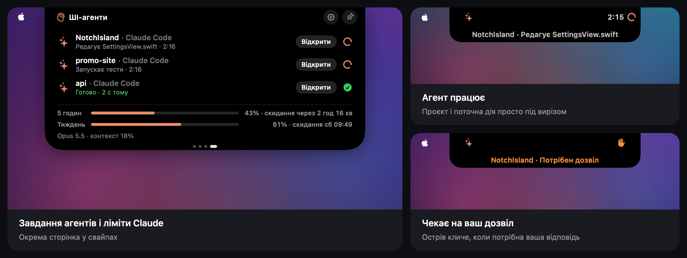
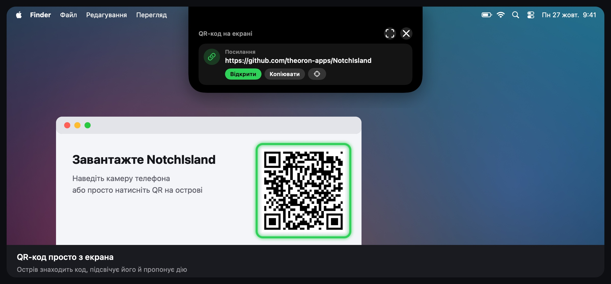

  

<h1 align="center">NotchIsland</h1>

Dynamic Island для MacBook з вирізом · від <a href="https://github.com/theoron-apps">Theoron</a>

  
  
  
  

  <a href="../../releases/latest"><b>Завантажити</b></a> ·
  <a href="README.md">English</a> · <a href="README.ru.md">Русский</a> · Українська

  

---

## Що вміє

  

- **ШІ-агенти** — Claude Code і Codex просто у вирізі: над яким проєктом працюють, що роблять зараз, коли чекають на ваш дозвіл, а ще ліміти Claude з попередженнями.
- **QR-сканер** — знаходить QR-коди на екрані, підсвічує їх і пропонує потрібну дію.
- **Музика** — Apple Music, Spotify, пісні з Telegram і звук із браузерів (Safari, Chrome, Firefox, Arc та інших) із живим еквалайзером і підсвіткою навколо острова.
- **Сповіщення у вирізі** — заряджання, AirPods та інші Bluetooth-пристрої, зміна мережі й VPN, сильне нагрівання, надто яскравий екран на батареї, компактна смужка гучності.
- **Активності** — таймер, «Не засинати», індикатори камери й мікрофона, дзвінки. До трьох активностей одразу, в одному з шести стилів на вибір.
- **Полиця** — лоток для файлів з AirDrop і конвертацією, історія буфера обміну, нотатка.
- **Статистика й батарея** — процесор, пам'ять, відеокарта, диск, мережа, температура, споживання у ватах і яскравість екрана в нітах, з кнопками швидких дій. Сторінки у свайпах можна розставити як завгодно.
- **Навчання** під час першого запуску та **«Що нового»** просто в острові після кожного оновлення.
- **Автоматична перевірка оновлень** — острів сам повідомить про нову версію.
- Три стилі острова (чорний, скло, матове скло), жести, тактильний відгук трекпада, м'яке світіння під час запуску. Українська, англійська та російська.

## ШІ-агенти

  

NotchIsland показує, що роблять ваші агенти, поки ви в іншому вікні:

- **Працює** — проєкт і поточна дія просто під вирізом: редагує файл, запускає команду, шукає.
- **Чекає на вас** — острів стає помаранчевим і клацає трекпадом, коли агенту потрібен дозвіл, він ставить запитання або чекає схвалення плану.
- **Готово** — коротке «Готово» у вирізі, коли завершилося довге завдання.
- **Ліміти Claude** — 5-годинний і тижневий, з часом скидання й попередженням на 70, 80, 90 і 100%.
- **Окрема сторінка** — свайп, і видно всі завдання агентів і ліміти одразу.

### Як підключити Claude Code і Codex

1. Відкрийте **«Налаштування» → «ШІ-агенти»** і натисніть **«Підключити…»** біля Claude Code.
2. Вікно вибору відкриється на папці `~/.claude` — натисніть **«Дозволити»**. NotchIsland збереже поруч копію `settings.json` і додасть свій хук і рядок стану. Ваші хуки залишаться.
3. Почніть нову сесію Claude Code.
4. Для Codex — те саме з папкою `~/.codex`. Codex запускає нові хуки лише після перевірки: виконайте в ньому `/hooks` і позначте хук NotchIsland як довірений.

Хочете вручну? На тій самій сторінці є покрокове ручне налаштування з усім, що треба скопіювати. **«Відключити»** прибирає хук, скрипт і рядок стану.

### Ліміти Claude

- **Claude Code у терміналі** передає ліміти сам, через рядок стану (підписки Pro і Max).
- **Застосунок Claude і claude.ai** ліміти не віддають, тому в NotchIsland є маленький помічник для браузера: раз на хвилину він бере ліміти з вашої сесії на claude.ai.
  - **Chrome, Arc, Edge, Brave** — у «Налаштування» → «ШІ-агенти» натисніть **«Зберегти розширення»**, відкрийте `chrome://extensions`, увімкніть **«Режим розробника»** і виберіть **«Завантажити розпаковане»** → папка «NotchIsland for Chrome» у «Завантаженнях».
  - **Safari** — встановіть безкоштовний застосунок [Userscripts](https://apps.apple.com/app/id1463298887), дозвольте його для claude.ai, натисніть **«Зберегти скрипт»** і перенесіть файл у папку скриптів Userscripts.

Помічник передає острову за адресою `127.0.0.1` лише відсотки лімітів і час скидання. Cookies і акаунт не залишають браузер. Спосіб неофіційний і може перестати працювати після оновлення claude.ai.

## QR-сканер

  

Натисніть кнопку **QR** на сторінці статистики або батареї. Острів шукає QR-коди на всіх екранах, підсвічує їх і пропонує потрібну дію: відкрити посилання, скопіювати пароль Wi‑Fi, додати контакт, написати листа, подзвонити або відкрити місце в Картах. Якщо код не знайшовся, обведіть його рамкою.

Сканеру потрібен доступ до **запису екрана**. Знімок потрібен лише щоб знайти код і ніде не зберігається. Застосунок поки без підпису Developer ID, тому після оновлення macOS може забути цей доступ — якщо сканер знову просить дозвіл, видаліть NotchIsland кнопкою **«−»** у «Системних параметрах» → «Приватність і безпека» → «Запис екрана» і дозвольте знову.

## Вимоги

- macOS 15 Sequoia або новіша
- Скляні стилі острова (Liquid Glass) — на macOS 26; на macOS 15 замість них розмиття
- MacBook з вирізом (на інших екранах — за бажанням)

## Встановлення

1. Завантажте `NotchIsland-<версія>.dmg` на сторінці [Releases](../../releases/latest).
2. Відкрийте DMG і перетягніть **NotchIsland** у **«Програми»**.
3. Відкрийте NotchIsland. macOS повідомить, що не може перевірити розробника, — натисніть **«Готово»**.
4. Відкрийте **«Системні параметри» → «Приватність і безпека»** та прокрутіть до розділу **«Безпека»**.
5. Поруч із повідомленням про NotchIsland натисніть **«Однаково відкрити»** і підтвердьте паролем або Touch ID.
6. Запустіть NotchIsland знову — далі він відкривається як зазвичай. Коротке навчання все покаже.

Чому так: застосунок поки що без платного підпису Apple (Developer ID), тому macOS один раз просить підтвердити запуск.

> Для досвідчених: замість кроків 3–5 можна виконати
> `xattr -dr com.apple.quarantine /Applications/NotchIsland.app`

## Як користуватися

| Дія | Що станеться |
|---|---|
| Навести курсор на виріз | Острів розкриється й покаже, що відбувається |
| Клацнути по острову | Відкриється полиця: лоток, історія буфера обміну й нотатка |
| Провести двома пальцями по розкритому острову | Перемикає сторінки: статистика, батарея, ШІ-агенти. Порядок і видимість — у **«Налаштування» → «Жести»** |
| Правий клік по острову | Швидке меню: таймер, «Не засинати», полиця, тест швидкості, налаштування |
| Перетягнути файл до вирізу | Покласти в лоток, надіслати через AirDrop або сконвертувати |
| Кнопки на сторінках статистики й батареї | «Не засинати», тест швидкості, монітор активності, полиця, QR-сканер, налаштування, закріплення |

Пройти навчання знову можна в **«Налаштування» → «Основні» → «Навчання»**.

## Дозволи

| Дозвіл | Навіщо |
|---|---|
| Автоматизація (Music, Spotify, System Events) | показувати трек, керувати плеєром, перемикати тему |
| Запис системного звуку | еквалайзер рухається від справжнього звуку; нічого не записується й не зберігається |
| Bluetooth | сповіщення про підключення навушників та інших пристроїв |
| Геопозиція | лише щоб macOS показала назву мережі Wi‑Fi |
| Буфер обміну | історія копіювання, якщо ви її ввімкнули |
| Запис екрана | лише для QR-сканера; знімок ніде не зберігається |
| Папки `~/.claude` і `~/.codex`, які ви вибираєте | щоб додати хук ШІ-агентів; поруч залишається копія налаштувань |

Будь-який дозвіл можна відкликати в **«Системних параметрах» → «Приватність і безпека»**.

## Оновлення

NotchIsland перевіряє нову версію під час запуску й раз на день. Коли вона вийде, острів запропонує **«Завантажити»**, нагадати **«Пізніше»** або **«Пропустити»** цю версію. Відкрийте новий DMG і замініть застосунок у «Програмах» — налаштування збережуться, а острів покаже, що нового.

Вимкнути перевірку або перевірити вручну можна в **«Налаштування» → «Про застосунок» → «Оновлення»**.

## Приватність

- Застосунок працює в пісочниці macOS і не збирає статистику.
- Історія буфера, нотатки й налаштування зберігаються лише на вашому Mac.
- ШІ-агенти: хуки передають острову локальним посиланням лише назву папки проєкту, подію й назву інструмента. Тексти запитів і вміст файлів не передаються. Помічник для браузера надсилає на `127.0.0.1` лише відсотки лімітів.
- У мережу застосунок звертається лише для тесту швидкості інтернету (сервери Apple, той самий сервіс, що й `networkQuality`) і для перевірки оновлень у цьому репозиторії, яка нічого про вас не передає.

## Видалення

Якщо ви підключали ШІ-агентів, спершу натисніть **«Відключити»** у «Налаштування» → «ШІ-агенти» й видаліть розширення або скрипт для браузера, якщо ставили. Без застосунку залишений хук нічого не робить, але так охайніше.

Закрийте NotchIsland (правий клік по острову → «Вийти з NotchIsland»), видаліть його з «Програм» і за бажанням теку `~/Library/Containers/devplaceholder.WAZ2022C.NotchIsland`.

## Зв'язок

Новини й питання — Telegram [@TheoronApps](https://t.me/TheoronApps).
