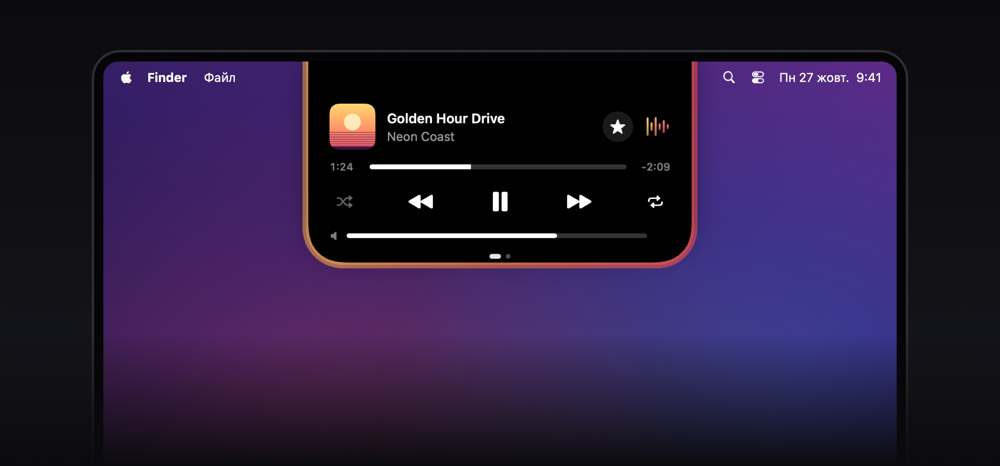
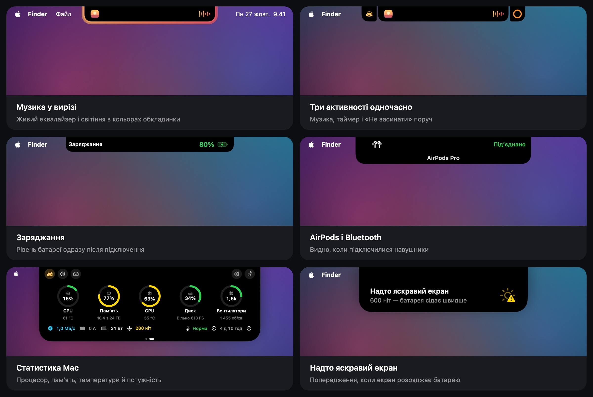

  

<h1 align="center">NotchIsland</h1>

Dynamic Island для MacBook з вирізом · від <a href="https://github.com/theoron-apps">Theoron</a>

  
  
  
  

  <a href="../../releases/latest"><b>Завантажити</b></a> ·
  <a href="README.md">English</a> · <a href="README.ru.md">Русский</a> · Українська

  

---

## Що вміє

  

- **Музика** — Apple Music, Spotify, пісні з Telegram і звук із браузерів (Safari, Chrome, Firefox, Arc та інших) із живим еквалайзером і підсвіткою навколо острова.
- **Сповіщення у вирізі** — заряджання, AirPods та інші Bluetooth-пристрої, зміна мережі й VPN, сильне нагрівання, надто яскравий екран на батареї, компактна смужка гучності.
- **Активності** — таймер, «Не засинати», індикатори камери й мікрофона, дзвінки. До трьох активностей одразу, в одному з шести стилів на вибір.
- **Полиця** — лоток для файлів з AirDrop і конвертацією, історія буфера обміну, нотатка.
- **Статистика й батарея** — процесор, пам'ять, відеокарта, диск, мережа, температура, споживання у ватах і яскравість екрана в нітах, з кнопками швидких дій.
- **Навчання** під час першого запуску та **«Що нового»** просто в острові після кожного оновлення.
- **Автоматична перевірка оновлень** — острів сам повідомить про нову версію.
- Три стилі острова (чорний, скло, матове скло), жести, тактильний відгук трекпада. Українська, англійська та російська.

## Вимоги

- macOS 15 Sequoia або новіша
- Скляні стилі острова (Liquid Glass) — на macOS 26; на macOS 15 замість них розмиття
- MacBook з вирізом (на інших екранах — за бажанням)

## Встановлення

1. Завантажте `NotchIsland-<версія>.dmg` на сторінці [Releases](../../releases/latest).
2. Відкрийте DMG і перетягніть **NotchIsland** у **«Програми»**.
3. Відкрийте NotchIsland. macOS повідомить, що не може перевірити розробника, — натисніть **«Готово»**.
4. Відкрийте **«Системні параметри» → «Приватність і безпека»** та прокрутіть до розділу **«Безпека»**.
5. Поруч із повідомленням про NotchIsland натисніть **«Однаково відкрити»** і підтвердьте паролем або Touch ID.
6. Запустіть NotchIsland знову — далі він відкривається як зазвичай. Коротке навчання все покаже.

Чому так: застосунок поки що без платного підпису Apple (Developer ID), тому macOS один раз просить підтвердити запуск.

> Для досвідчених: замість кроків 3–5 можна виконати
> `xattr -dr com.apple.quarantine /Applications/NotchIsland.app`

## Як користуватися

| Дія | Що станеться |
|---|---|
| Навести курсор на виріз | Острів розкриється й покаже, що відбувається |
| Клацнути по острову | Відкриється полиця: лоток, історія буфера обміну й нотатка |
| Провести двома пальцями по розкритому острову | Статистика Mac і батарея |
| Правий клік по острову | Швидке меню: таймер, «Не засинати», полиця, тест швидкості, налаштування |
| Перетягнути файл до вирізу | Покласти в лоток, надіслати через AirDrop або сконвертувати |
| Кнопки на сторінках статистики й батареї | «Не засинати», тест швидкості, монітор активності, полиця, налаштування, закріплення |

Пройти навчання знову можна в **«Налаштування» → «Основні» → «Навчання»**.

## Дозволи

| Дозвіл | Навіщо |
|---|---|
| Автоматизація (Music, Spotify, System Events) | показувати трек, керувати плеєром, перемикати тему |
| Запис системного звуку | еквалайзер рухається від справжнього звуку; нічого не записується й не зберігається |
| Bluetooth | сповіщення про підключення навушників та інших пристроїв |
| Геопозиція | лише щоб macOS показала назву мережі Wi‑Fi |
| Буфер обміну | історія копіювання, якщо ви її ввімкнули |

Будь-який дозвіл можна відкликати в **«Системних параметрах» → «Приватність і безпека»**.

## Оновлення

NotchIsland перевіряє нову версію під час запуску й раз на день. Коли вона вийде, острів запропонує **«Завантажити»**, нагадати **«Пізніше»** або **«Пропустити»** цю версію. Відкрийте новий DMG і замініть застосунок у «Програмах» — налаштування збережуться, а острів покаже, що нового.

Вимкнути перевірку або перевірити вручну можна в **«Налаштування» → «Про застосунок» → «Оновлення»**.

## Приватність

- Застосунок працює в пісочниці macOS і не збирає статистику.
- Історія буфера, нотатки й налаштування зберігаються лише на вашому Mac.
- У мережу застосунок звертається лише для тесту швидкості інтернету (сервери Apple, той самий сервіс, що й `networkQuality`) і для перевірки оновлень у цьому репозиторії, яка нічого про вас не передає.

## Видалення

Закрийте NotchIsland (правий клік по острову → «Вийти з NotchIsland»), видаліть його з «Програм» і за бажанням теку `~/Library/Containers/devplaceholder.WAZ2022C.NotchIsland`.

## Зв'язок

Новини й питання — Telegram [@TheoronApps](https://t.me/TheoronApps).
