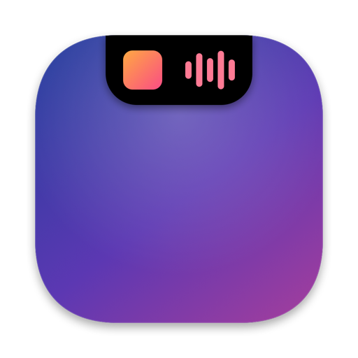

  

<h1 align="center">NotchIsland</h1>

Dynamic Island для MacBook з вирізом · від <a href="https://github.com/theoron-apps">Theoron</a>

  <a href="../../releases/latest"><b>Завантажити</b></a> ·
  <a href="README.md">English</a> · <a href="README.ru.md">Русский</a> · Українська

---

## Що вміє

- **Музика** — Apple Music, Spotify, пісні з Telegram і звук із браузерів із живим еквалайзером і підсвіткою навколо острова.
- **Сповіщення у вирізі** — заряджання, AirPods та інші Bluetooth-пристрої, зміна мережі й VPN, сильне нагрівання, гучність.
- **Активності** — таймер, «Не засинати», індикатори камери й мікрофона, дзвінки.
- **Полиця** — лоток для файлів з AirDrop, історія буфера обміну, нотатка.
- **Статистика й батарея** — процесор, пам'ять, мережа, температура, споживання у ватах.
- Три стилі острова, жести, тактильний відгук трекпада. Українська, англійська та російська.

## Вимоги

- macOS 26.7.1 або новіша
- MacBook з вирізом (на інших екранах — за бажанням)

## Встановлення

1. Завантажте `NotchIsland-<версія>.dmg` на сторінці [Releases](../../releases/latest).
2. Відкрийте DMG і перетягніть **NotchIsland** у **«Програми»**.
3. Відкрийте NotchIsland. macOS повідомить, що не може перевірити розробника, — натисніть **«Готово»**.
4. Відкрийте **«Системні параметри» → «Приватність і безпека»** та прокрутіть до розділу **«Безпека»**.
5. Поруч із повідомленням про NotchIsland натисніть **«Однаково відкрити»** і підтвердьте паролем або Touch ID.
6. Запустіть NotchIsland знову — далі він відкривається як зазвичай.

Чому так: застосунок поки що без платного підпису Apple (Developer ID), тому macOS один раз просить підтвердити запуск.

> Для досвідчених: замість кроків 3–5 можна виконати
> `xattr -dr com.apple.quarantine /Applications/NotchIsland.app`

## Дозволи

| Дозвіл | Навіщо |
|---|---|
| Автоматизація (Music, Spotify, System Events) | показувати трек, керувати плеєром, перемикати тему |
| Запис системного звуку | еквалайзер рухається від справжнього звуку; нічого не записується й не зберігається |
| Bluetooth | сповіщення про підключення навушників та інших пристроїв |
| Геопозиція | лише щоб macOS показала назву мережі Wi‑Fi |
| Буфер обміну | історія копіювання, якщо ви її ввімкнули |

Будь-який дозвіл можна відкликати в **«Системних параметрах» → «Приватність і безпека»**.

## Оновлення

Завантажте новий DMG і замініть застосунок у «Програмах». Після оновлення острів сам покаже, що нового. Налаштування зберігаються.

## Приватність

- Застосунок працює в пісочниці macOS і не збирає статистику.
- Історія буфера, нотатки й налаштування зберігаються лише на вашому Mac.
- У мережу застосунок звертається лише для тесту швидкості інтернету (сервери Apple, той самий сервіс, що й `networkQuality`).

## Видалення

Закрийте NotchIsland (правий клік по острову → «Вийти»), видаліть його з «Програм» і за бажанням теку `~/Library/Containers/devplaceholder.WAZ2022C.NotchIsland`.

## Зв'язок

Новини й питання — Telegram [@TheoronApps](https://t.me/TheoronApps).
