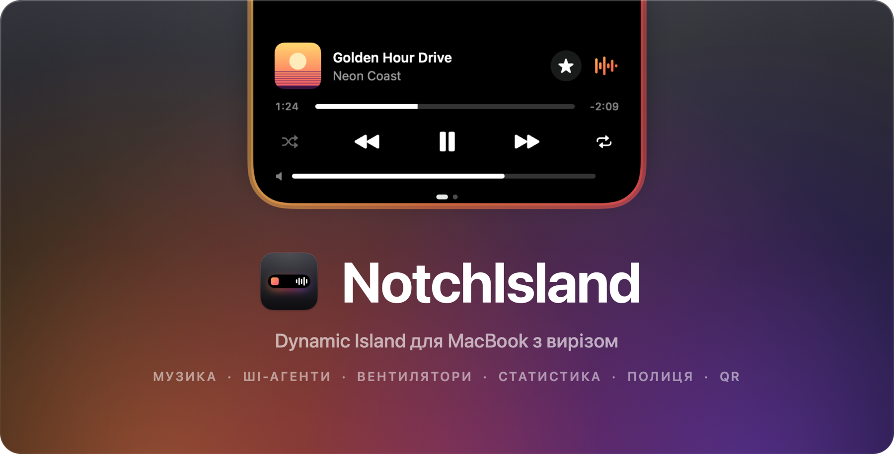
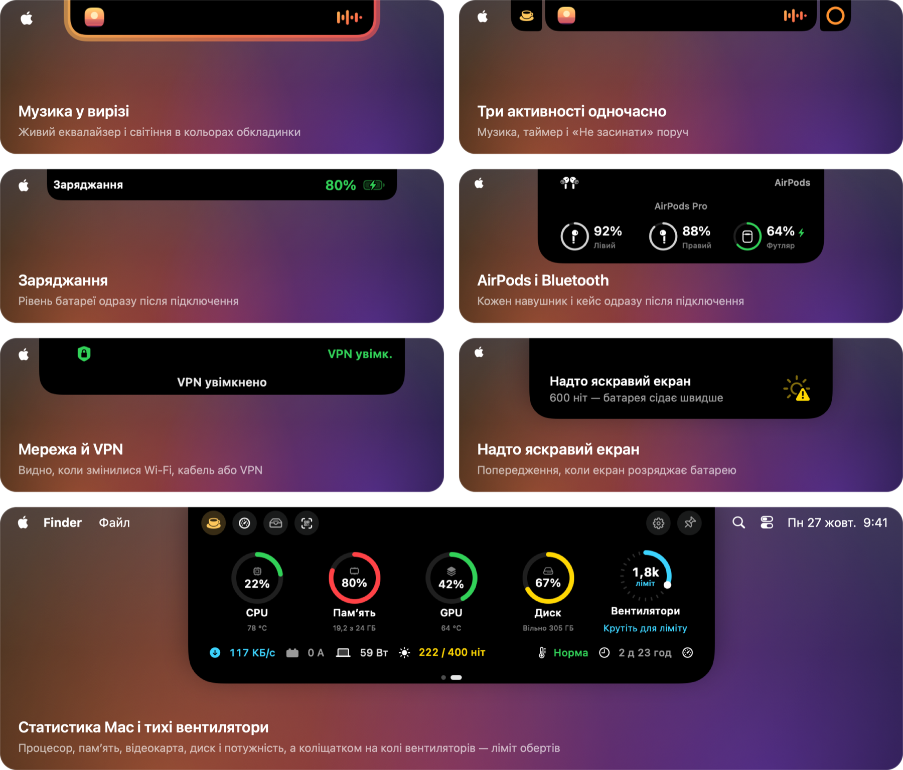
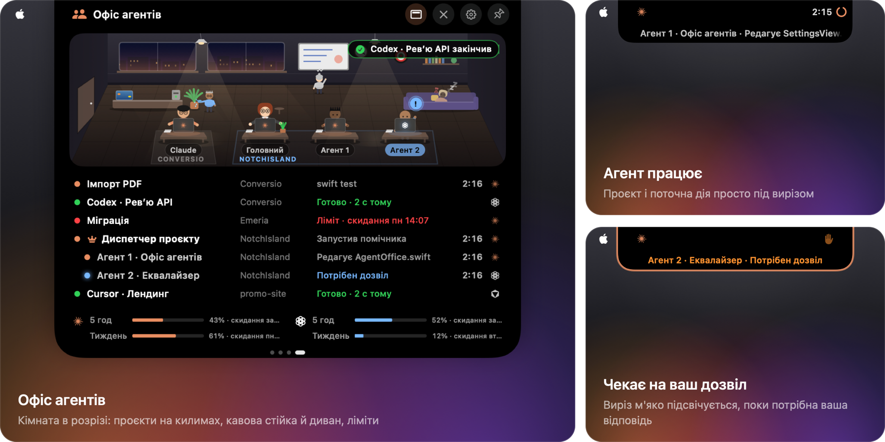
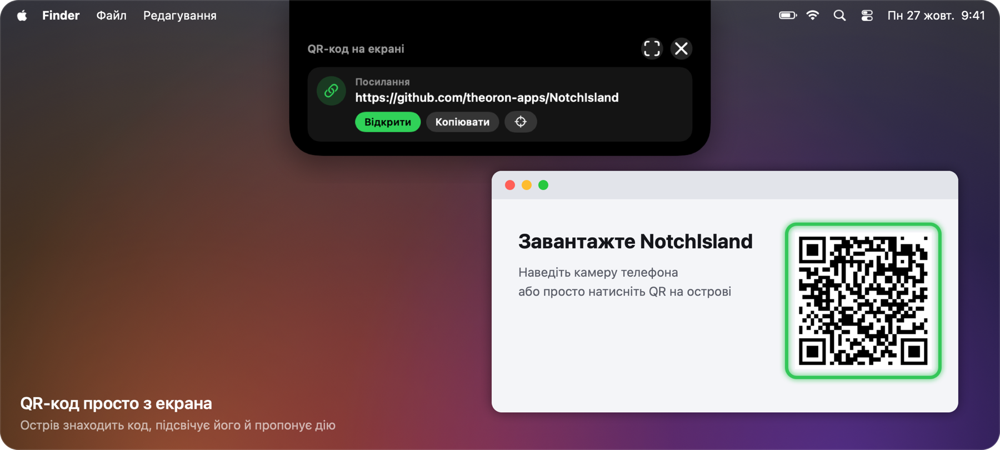

  

  
  
  
  
  

  від <a href="https://github.com/theoron-apps">Theoron</a> · <a href="README.md">English</a> · <a href="README.ru.md">Русский</a> · Українська

---

## Що вміє

  

- **Ліміт обертів вентиляторів** — наведіть курсор на коло вентиляторів у статистиці й крутіть коліщатко: крок 100 об/хв, від «Авто» до повної тиші. Mac залишається тихим під навантаженням, а вище заданої вами температури вентилятори самі повертаються на автоматику. Mac з Apple Silicon і вентиляторами.
- **Офіс агентів** — Claude Code, Codex, Cursor і Antigravity у кімнаті-розрізі за столами своїх проєктів: видно, хто працює, хто чекає на ваш дозвіл, хто закінчив і хто вперся в ліміт. Агент, що чекає, підсвічує виріз, а ще є ліміти Claude, Codex і Cursor з попередженнями.
- **QR-сканер** — знаходить QR-коди на екрані, підсвічує їх і пропонує потрібну дію.
- **Еквалайзер для всіх застосунків** — музика й відео з будь-якого плеєра, а не лише з Apple Music і Spotify: YouTube у Safari, Chrome і Brave, подкасти, VLC, IINA, пісні з Telegram, а поки звучить FL Studio — і вона. Назва, час, перемотування й кнопки просто в острові, а з розширенням NotchIsland для браузера — ще й кадр відео з каналом. Живий еквалайзер у чотирьох стилях — «Як на iPhone», «Миттєвий», NotchIsland із налаштуванням смужок і «Просто смужки», — підсвітка навколо острова й вузький варіант впритул до вирізу.
- **Сповіщення у вирізі** — заряджання, AirPods та інші Bluetooth-пристрої, зміна мережі й VPN, другий Mac кабелем Thunderbolt, сильне нагрівання, надто яскравий екран на батареї, компактна смужка гучності.
- **Активності** — таймер, «Не засинати», індикатори камери й мікрофона, дзвінки. До трьох активностей одразу, в одному з шести стилів на вибір.
- **Полиця** — лоток для файлів з AirDrop, конвертацією і зняттям пароля з PDF, історія буфера обміну, нотатка.
- **Статистика й батарея** — процесор, пам'ять, відеокарта, диск, мережа, температура, споживання у ватах і яскравість екрана в нітах, з кнопками швидких дій. Натисніть на коло «Пам'ять» — відкриється список застосунків і процесів із пам'яттю, CPU та GPU, і зайве можна завершити просто з острова. Сторінки у свайпах можна розставити як завгодно.
- **Навчання** під час першого запуску та **«Що нового»** просто в острові після кожного оновлення.
- **Автоматична перевірка оновлень** — острів сам повідомить про нову версію.
- Жести, тактильний відгук трекпада, м'яке світіння під час запуску. Українська, англійська та російська.

## ШІ-агенти

  

NotchIsland показує, що роблять ваші агенти, поки ви в іншому вікні:

- **Офіс агентів** — окрема вкладка розкритого острова. Це кімната в розрізі: вікна з містом або зорями, лампи під стелею. Агенти, що працюють, сидять за столами, агенти одного проєкту — на спільному килимі з його назвою. Той, хто чекає, встає й махає, а килим підсвічується. Ті, хто закінчив, ідуть у зону відпочинку й самі знаходять заняття: кава, дартс, рибки, дошка, гітара. Ті, хто вперся в ліміт, і ті, хто давно закінчив, відпочивають на дивані. П'ять тем оформлення: «Студія», «Нічне місто», «Орбіта», «Майстерня» і «Неон». Нижче — список сесій: назва чату, проєкт, що агент робить зараз і скільки часу. Наведіть курсор на рядок — агент у кімнаті підсвітиться, і навпаки. Під агентом Claude видно його помічників. Завершені сесії лишаються у списку 30 хвилин. Поки офіс відкрито, про кінець роботи й очікування повідомляють плашки в кутку кімнати — острів не перемикається. Вкладку можна прибрати хрестиком і повернути в налаштуваннях.
- **Головний чат і форки** — якщо в проєкті є чати «Агент N · …», чат без номера вважається головним: у списку в нього корона, у кімнаті він сидить першим, у піджаку й із квіткою на столі, а форки — поруч і простіше. Номерів, яких немає в назвах чатів, NotchIsland не вигадує; чати Codex підписано «Codex · назва».
- **Працює** — проєкт і поточна дія просто під вирізом: редагує файл, запускає команду, шукає.
- **Чекає на вас** — виріз м'яко пульсує й клацає трекпадом, коли агенту потрібен дозвіл, він ставить запитання або чекає схвалення плану. Колір, яскравість і системний звук підсвічування налаштовуються в «ШІ-агентах».
- **Готово** — коротке «Готово» у вирізі, коли закінчилося довге завдання.
- **Ліміти** — у Claude і Codex 5-годинний і тижневий, у Cursor місячні Auto і API, з часом скидання й попередженням на 70, 80, 90 і 100%. Якщо ліміти є в кількох агентів, між ними можна перемикатися вкладками просто на острові.

| Агент | Завдання й статус | Чекає на дозвіл | Ліміти |
|---|---|---|---|
| Claude Code | ✓ | ✓ | 5 годин і тиждень |
| Codex | ✓ | ✓ | 5 годин і тиждень, із журналу сесій Codex |
| Cursor | ✓ | — | Auto і API, через помічника для браузера |
| Antigravity | ✓ | — | — |

Cursor і Antigravity не повідомляють хукам, що чекають на ваш дозвіл, тож острів не може цього показати. Ліміти Antigravity не віддає взагалі — ні через хуки, ні на сайті.

### Як підключити агентів

1. Відкрийте **«Налаштування» → «ШІ-агенти»** і натисніть **«Підключити…»** біля Claude Code.
2. NotchIsland збереже поруч копію `~/.claude/settings.json` і додасть свій хук і рядок стану. Ваші хуки залишаться.
3. Почніть нову сесію Claude Code.
4. Для Codex натисніть **«Підключити…»** біля нього, а потім схваліть хуки в Codex: без цього він їх не запускає. У застосунку Codex натисніть **Allow all** у вікні **Review hooks** над полем введення або відкрийте **«Налаштування» → Hooks** і натисніть **Trust** біля кожного хука NotchIsland. У терміналі Codex — команда `/hooks`.
5. Для Cursor натисніть **«Підключити…»** і перезапустіть Cursor. Хук додасться в `~/.cursor/hooks.json`.
6. Для Antigravity натисніть **«Підключити…»** і перезапустіть Antigravity — він читає хуки лише під час запуску. Хук додасться в `~/.gemini/config/hooks.json`.

Для кожного агента на тій самій сторінці є покрокова інструкція, а ще ручне налаштування з усім, що треба скопіювати. **«Відключити»** прибирає хук, скрипт і рядок стану.

### Ліміти

- **Codex** сам записує ліміти у свій журнал сесій на вашому Mac, а острів читає їх після кожної відповіді агента. Нічого встановлювати не треба.
- **Claude Code у терміналі** передає ліміти сам, через рядок стану (підписки Pro і Max).
- **Застосунок Claude, claude.ai і Cursor** ліміти не віддають, тому в NotchIsland є маленький помічник для браузера: щохвилини він бере ліміти з вашої сесії на claude.ai і cursor.com.
  - **Chrome, Arc, Edge, Brave** — у «Налаштування» → «ШІ-агенти» натисніть **«Зберегти розширення»**, відкрийте `chrome://extensions`, увімкніть **«Режим розробника»** і виберіть **«Завантажити розпаковане»** → тека «NotchIsland for Chrome» у «Завантаженнях». Вже встановлювали стару версію? Збережіть розширення знову й натисніть **«Оновити»** біля нього.
  - **Safari** — встановіть безкоштовний застосунок [Userscripts](https://apps.apple.com/app/id1463298887), дозвольте його для claude.ai і cursor.com, натисніть **«Зберегти скрипт»** і перенесіть файл у теку скриптів Userscripts замість старого.

Помічник передає острову за адресою `127.0.0.1` лише відсотки лімітів і час скидання. Cookies і акаунт не залишають браузер. Спосіб неофіційний і може перестати працювати після оновлення claude.ai або cursor.com.

## QR-сканер

  

Натисніть кнопку **QR** на сторінці статистики або батареї. Острів шукає QR-коди на всіх екранах, підсвічує їх і пропонує потрібну дію: відкрити посилання, скопіювати пароль Wi‑Fi, додати контакт, написати листа, подзвонити або відкрити місце в Картах. Якщо код не знайшовся, обведіть його рамкою.

Сканеру потрібен доступ до **запису екрана**. Знімок потрібен лише щоб знайти код і ніде не зберігається. Застосунок поки без підпису Developer ID, тому після оновлення macOS може забути цей доступ — якщо сканер знову просить дозвіл, видаліть NotchIsland кнопкою **«−»** у «Системних параметрах» → «Приватність і безпека» → «Запис екрана» і дозвольте знову.

## Вимоги

- macOS 15 Sequoia або новіша
- MacBook з вирізом (на інших екранах — за бажанням)

## Встановлення

1. Завантажте `NotchIsland-<версія>.dmg` на сторінці [Releases](../../releases/latest).
2. Відкрийте DMG і перетягніть **NotchIsland** у **«Програми»**.
3. Відкрийте NotchIsland. macOS повідомить, що не може перевірити розробника, — натисніть **«Готово»**.
4. Відкрийте **«Системні параметри» → «Приватність і безпека»** та прокрутіть до розділу **«Безпека»**.
5. Поруч із повідомленням про NotchIsland натисніть **«Однаково відкрити»** і підтвердьте паролем або Touch ID.
6. Запустіть NotchIsland знову — далі він відкривається як зазвичай. Коротке навчання все покаже.

Чому так: застосунок поки що без платного підпису Apple (Developer ID), тому macOS один раз просить підтвердити запуск.

> Для досвідчених: замість кроків 3–5 можна виконати
> `xattr -dr com.apple.quarantine /Applications/NotchIsland.app`

## Як користуватися

| Дія | Що станеться |
|---|---|
| Навести курсор на виріз | Острів розкриється й покаже, що відбувається |
| Клацнути по острову | Відкриється полиця: лоток, історія буфера обміну й нотатка |
| Провести двома пальцями по розкритому острову | Перемикає сторінки: статистика, батарея, офіс агентів. Порядок і видимість — у **«Налаштування» → «Жести»** |
| Змахнути двома пальцями вгору по острову | Острів ховається у виріз. Змахніть униз по вирізу, щоб повернути; нова активність або трек теж повернуть його |
| Правий клік по острову | Швидке меню: таймер, «Не засинати», полиця, тест швидкості, налаштування |
| Перетягнути файл до вирізу | Покласти в лоток, надіслати через AirDrop або сконвертувати |
| Кнопки на сторінках статистики й батареї | «Не засинати», тест швидкості, монітор активності, полиця, QR-сканер, налаштування, закріплення |

Пройти навчання знову можна в **«Налаштування» → «Основні» → «Навчання»**.

## Дозволи

| Дозвіл | Навіщо |
|---|---|
| Автоматизація (Music, Spotify, System Events) | показувати трек, керувати плеєром, перемикати тему |
| Запис системного звуку | еквалайзер рухається від справжнього звуку; нічого не записується й не зберігається |
| Bluetooth | сповіщення про підключення навушників та інших пристроїв |
| Геопозиція | лише щоб macOS показала назву мережі Wi‑Fi |
| Буфер обміну | історія копіювання, якщо ви її ввімкнули |
| Запис екрана | лише для QR-сканера; знімок ніде не зберігається |
| Папки `~/.claude`, `~/.codex`, `~/.cursor` і `~/.gemini`, лише коли ви натискаєте **«Підключити…»** | щоб додати хук ШІ-агентів; поруч залишається копія налаштувань |
| Пароль адміністратора | лише щоб встановити або видалити помічника вентиляторів, якщо ви ввімкнули ліміт обертів |

Будь-який дозвіл можна відкликати в **«Системних параметрах» → «Приватність і безпека»**.

## Вентилятори й пісочниця

З версії 6.1 NotchIsland працює без пісочниці macOS. Змінювати оберти вентиляторів macOS дозволяє лише процесу з правами адміністратора, а застосунок у пісочниці не може його встановити. Тому всередині пісочниці ліміту обертів бути не може.

- Оберти змінює маленький помічник, вбудований у застосунок. Коли ви вмикаєте керування вентиляторами, він копіюється в `/Library/PrivilegedHelperTools` і реєструється в `/Library/LaunchDaemons`, обидва файли називаються `devplaceholder.WAZ2022C.NotchIsland.FanHelper`.
- Помічник уміє лише дві речі: тримати вентилятори на заданих обертах у межах, які повідомляє сам Mac, або повернути їх macOS. Він приймає команди лише від NotchIsland, повертає вентиляторам автоматику, якщо острів закрився, упав або 20 секунд нічого не надсилав, і сам вимикається без діла.
- Він ставиться, лише якщо ви ввімкнете **«Налаштування» → «Дозволи» → «Керування вентиляторами»** і введете пароль адміністратора. Кнопка **«Вимкнути»** знову попросить пароль і видалить обидва файли.
- Острів теж повертає вентилятори macOS вище температури чипа (процесора або відеокарти — що гарячіше), яку ви задаєте в «Налаштування» → «Дозволи», і в будь-якому разі при 100 °C або коли macOS повідомляє про критичний нагрів.
- Керування вентиляторами працює лише на Mac з Apple Silicon і вентиляторами. Як і інші програми для вентиляторів, NotchIsland напряму читає й пише в контролер Mac (SMC), а це не публічний API Apple.
- Більше нічого не змінилося: статистика не збирається, нового доступу до мережі немає. Налаштування та історія буфера під час першого запуску самі переїжджають зі старого контейнера пісочниці.

## Оновлення

NotchIsland перевіряє нову версію під час запуску й раз на день. Коли вона вийде, острів запропонує **«Завантажити»**, нагадати **«Пізніше»** або **«Пропустити»** цю версію. Відкрийте новий DMG і замініть застосунок у «Програмах» — налаштування збережуться, а острів покаже, що нового.

Вимкнути перевірку або перевірити вручну можна в **«Налаштування» → «Що нового» → «Оновлення»**.

## Приватність

- Застосунок не збирає статистику. З версії 6.1 він працює без пісочниці — докладніше в розділі [«Вентилятори й пісочниця»](#вентилятори-й-пісочниця).
- Історія буфера, нотатки й налаштування зберігаються лише на вашому Mac.
- ШІ-агенти: хуки передають острову локальним посиланням лише назву папки проєкту, подію й назву інструмента. Назви чатів і стан сесій офіс читає на вашому Mac із папок `~/.claude` і `~/.codex` підключених агентів, лише з кінця журналів. Тексти листувань не зберігаються й нікуди не передаються. Помічник для браузера надсилає на `127.0.0.1` лише відсотки лімітів і відео YouTube, яке ви дивитеся (назву, канал, час).
- У мережу застосунок звертається лише для тесту швидкості інтернету (сервери Apple, той самий сервіс, що й `networkQuality`) для перевірки оновлень у цьому репозиторії, яка нічого про вас не передає, і по кадр відео YouTube з `i.ytimg.com`, якщо ввімкнено розширення для браузера.

## Видалення

Якщо ви підключали ШІ-агентів, спершу натисніть **«Відключити»** у «Налаштування» → «ШІ-агенти» й видаліть розширення або скрипт для браузера, якщо ставили. Без застосунку залишений хук нічого не робить, але так охайніше. Якщо вмикали керування вентиляторами, натисніть **«Вимкнути»** у «Налаштування» → «Дозволи» — інакше бездіяльний помічник залишиться в `/Library/PrivilegedHelperTools`.

Закрийте NotchIsland (правий клік по острову → «Вийти з NotchIsland»), видаліть його з «Програм» і за бажанням `~/Library/Application Support/NotchIsland`, `~/Library/Preferences/devplaceholder.WAZ2022C.NotchIsland.plist` і стару теку `~/Library/Containers/devplaceholder.WAZ2022C.NotchIsland`.

## Торговельні марки

Claude і Claude Code — торговельні марки Anthropic, Codex — OpenAI, Cursor — Anysphere, Antigravity — Google. NotchIsland — незалежний застосунок і не пов’язаний із цими компаніями, не спонсорується й не схвалений ними. Значки агентів у застосунку — спрощені малюнки, лише щоб агентів було легко розрізнити.

## Зв'язок

Новини й питання — Telegram [@TheoronApps](https://t.me/TheoronApps).
